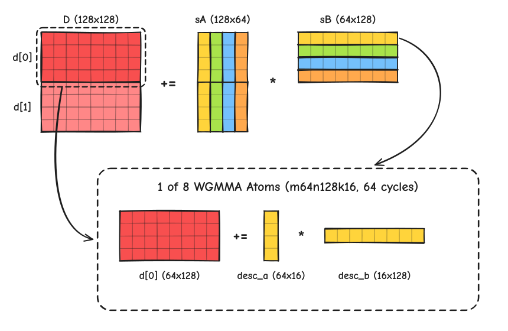
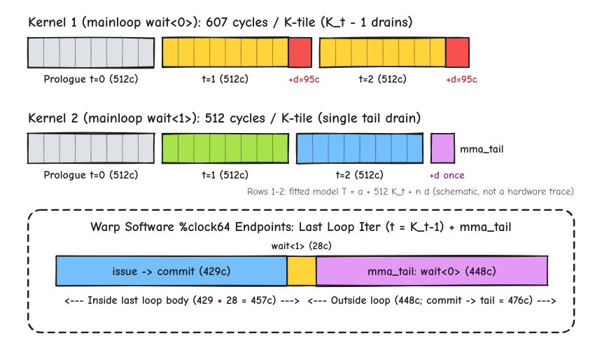
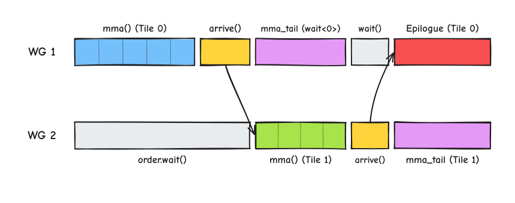

# Hopper 单 CTA WGMMA 主循环与局部 TMA 流水线：从 `wait<0>` 到 `512 cycle` 增量斜率

本文讨论 NVIDIA Hopper（`sm_90a`，GH200）在**单 CTA、空载条件**下的计算 Warpgroup 主循环构造与局部 TMA 供数衔接（预设读者已了解 GEMM 分块、Warpgroup 概念与 `mbarrier` 基本语义；多 CTA 并发争用、矩阵行距/Stage 响应及完整 Kernel 性能不在本文实验范围内）。

围绕同一个 `128 × 128 × 64` 计算分块，正文结合 GH200 上的 `%clock64` 实测数据与 CUTLASS v3.9.2 源码，依次对比三个递进版本，并在最后讨论 CUTLASS Ping-Pong 双 Warpgroup 的交接顺序：

- **Kernel 1（常驻 SMEM + 主循环 `wait_group<0>`）**：Prologue 预提交首组后，主循环每步使用 `warpgroup_wait<0>()` 将在途批次排空至 0（共排空 $K_t - 1$ 次），窗口随 $K_t$ 增长的差分斜率为 `607.0 cycles / K-tile`（约为理论峰值速率的 `84.3%`）；
- **Kernel 2（常驻 SMEM + 主循环 `wait_group<1>` + 滞后释放）**：将主循环改为 `warpgroup_wait<1>()`，允许至多 1 个提交组尚未完成，将共享内存槽位释放推迟 1 个 K-tile，仅在末尾 `mma_tail` 执行一次 `wait_group<0>()`，窗口随 $K_t$ 的增长斜率降至理论下界 **`512.0 cycles / K-tile`**；
- **Kernel 3（接入单 CTA 6 阶段原生 TMA 流水线）**：在滞后释放骨架上接入 6 槽 full/empty 屏障与 TMA 搬运（探针按 `PipelineTmaAsync` 的同一协议手写，每 K-tile 三笔 TMA 共 `32 KiB`）。在已测的 $K_t = 4 \to 13$ 区间内，其长度增长与带 full/empty 同步的常驻版本基本一致（`4,585` 对 `4,584 cycles`），附加窗口差保持在 `883 / 884 cycles`。

---

## 硬件基线：`128×128×64` K-tile 的 `512 cycles` 理想计算周期下界

固定单个计算 Warpgroup（4 个连续 Warp，128 个线程）计算分块尺寸 `bM × bN × bK = 128 × 128 × 64`（FP16 稠密输入，FP32 累加）。操作数 `sA`（`128×64`，FP16）和 `sB`（`64×128`，FP16）位于共享内存中，累加器 `D`（`128×128`，FP32）驻留在线程寄存器（RMEM）中，每线程持有 128 个 FP32 累加寄存器（分为上下两个 `64×128` 子块 `d[0]` 和 `d[1]`，每组 64 个寄存器）。

该分块形状对应的 MMA Atom 为 `MMA_64x128x16_F32F16F16_SS`，底层 PTX 指令为 `wgmma.mma_async.sync.aligned.m64n128k16.f32.f16.f16`（SASS 指令为 `HGMMA.64x128x16.F32`）。单条指令通过两个 64 位共享内存矩阵描述符 `desc_a`（指向 `64×16` 子块）与 `desc_b`（指向 `16×128` 子块）读取操作数，完成 $(64 \times 128) \mathrel{+}= (64 \times 16) \times (16 \times 128)$ 矩阵乘加。覆盖一个 `128 × 128 × 64` K-tile 需沿 `M` 维切分 2 块（`d[0]` 与 `d[1]`）、沿 `K` 维迭代 4 步（`k0..k3`，步长 16），共发射 `2 × 4 = 8` 条 WGMMA 指令：



单条 `m64n128k16` 指令执行 $64 \times 128 \times 16 = 131{,}072\text{ FMA}$（即 $262{,}144\text{ FLOP}$）。Hopper 单 SM FP16 稠密 Tensor Core 的理论峰值吞吐为 `2,048 FMA/cycle`（即 `4,096 FLOP/cycle`，微基准实测为 `4,095.9 FLOP/cycle`），因此单条指令的理想硬件服务时间为：

$$\frac{131{,}072\text{ FMA}}{2{,}048\text{ FMA/cycle}} = \frac{262{,}144\text{ FLOP}}{4{,}096\text{ FLOP/cycle}} = 64\text{ cycles}$$

由此可得，完成 1 个 K-tile（8 条指令）的理想计算周期下界为：

$$T_{\text{roofline}}(\text{K-tile}) = 8 \times 64\text{ cycles} = 512\text{ cycles}$$

下文以 **`512.0 cycles / K-tile`** 作为衡量主循环随归约步数 $K_t$ 增长的边际斜率基准。

---

## Kernel 1：常驻 SMEM + 主循环同步排空（`warpgroup_wait<0>()`）

为隔离全局内存与 TMA 访存干扰，首先将 6 个槽位的 FP16 操作数预先写入共享内存。PTX 规范通过三条同步原语管理 `wgmma.mma_async` 的生命周期：

1. `warpgroup_arrive()`（`wgmma.fence.sync.aligned`）：建立累加器寄存器 `d[0..1]` 的访问顺序约束；
2. `warpgroup_commit_batch()`（`wgmma.commit_group.sync.aligned`）：将当前 K-tile 已发射的 8 条 `wgmma.mma_async` 封装为一个提交组（`wgmma-group`）；
3. `warpgroup_wait<N>()`（`wgmma.wait_group.sync.aligned N`，SASS 为 `DEPBAR.LE SB0, N`）：阻塞当前 Warpgroup，直至未完成的在途提交组数不超过 `N`。

为了与后续 `Kernel 2` 严格控制变量（保持寄存器分配与其余全部 SASS 指令完全相同，仅改变主循环内 `DEPBAR.LE SB0` 的立即数），实测探针的 `wait<0>` 版本采用相同的三段结构：Prologue 先提交 `tile 0`（不执行 `wait`），随后的 $K_t - 1$ 轮主循环在提交当前 `tile t` 后调用 `warpgroup_wait<0>()` 将在途提交组全部排空至 0，最后在 `mma_tail` 执行一次收口 `warpgroup_wait<0>()`：

```cpp
// Kernel 1（对应实测探针 wait<0> 版本）：Prologue 预提交 + 主循环每步 wait_group<0> 排空 (共排空 K_t - 1 次)
// 1. Prologue：提交 tile 0，不执行 wait
warpgroup_arrive();
issue_tile_8x_wgmma(sA, sB, /*slot=*/0, /*is_first=*/true, d);
warpgroup_commit_batch();

// 2. Mainloop (K_t - 1 步)：每轮提交 tile t 后，执行 wait_group<0> 将在途组排空为 0
for (int tile = 1; tile < ktiles; ++tile) {
  int read_slot = tile % 6;
  warpgroup_arrive();
  issue_tile_8x_wgmma(sA, sB, read_slot, /*is_first=*/false, d);
  warpgroup_commit_batch();

  warpgroup_wait<0>();                      // DEPBAR.LE SB0, 0x0：阻塞至在途组数降为 0
}

// 3. mma_tail：末尾收口 wait_group<0>
warpgroup_wait<0>();
```

**计时窗口说明**：共享内存操作数准备完成后，线程 0 读取起始 `%clock64`，随后 CTA 执行起始会合（`__syncthreads()`）并进入计算主循环；完成全部 K-tile 的 WGMMA 发射、末尾 `warpgroup_wait<0>()`、累加器寄存器消费及结束会合后，再读取结束 `%clock64`。计时窗口包含起始与结束会合，不包含共享内存初始填充及全局结果导出。因此，单个测量窗口除包含 $K_t$ 步计算外，还包含固定的会合与尾消费开销；下文中的“峰值速率占比”均指**窗口周期随 $K_t$ 增长的差分斜率**相对于 `512.0 cycles / K-tile` 的比值。

在 GH200（ARM CUDA 12.9，154 寄存器/线程，无寄存器溢出）上对 $K_t \in \{4, 13, 32\}$ 的实测窗口周期如下：

| 归约步数 $K_t$ | 总 WGMMA 指令数 | 主循环 `wait<0>` 次数 ($K_t - 1$) | `Kernel 1` (`wait<0>`) 实测中位周期 | 相邻差分斜率 ($\Delta\text{cycles} / \Delta K_t$) | 边际斜率相对 `512c` 占比 |
|---:|---:|---:|---:|---:|---:|
| `4` | `32` | `3` | `3,014` | — | — |
| `13` | `104` | `12` | `8,477` | **`607.0`** | `84.3%` |
| `32` | `256` | `31` | `20,010` | **`607.0`** | `84.3%` |

在操作数已常驻共享内存的条件下，`Kernel 1` 在 $K_t = 4 \to 13$ 与 $K_t = 13 \to 32$ 两个区间内，每增加一个 K-tile 均固定增加 **`607.0 cycles`**（$(8477 - 3014)/9 = 607.0$，$(20010 - 8477)/19 = 607.0$），比 `512.0 cycles` 的理想服务时间多出 **`95.0 cycles / K-tile`**（单步增量耗时 `+18.6%`，对应边际吞吐下降 `-15.7%`）。

在受控实验模型中，我们将主循环每执行一次 `warpgroup_wait<0>()` 相比 `warpgroup_wait<1>()` 多暴露出的这部分固定时间记为完成滞后参数 $d = 95\text{ cycles}$。[PTX `wgmma.wait_group` 规范](https://docs.nvidia.com/cuda/parallel-thread-execution/index.html#asynchronous-warpgroup-level-matrix-multiply-accumulate-instructions-wgmma-wait-group)仅规定了等待返回的同步条件，并未说明这部分额外周期在硬件内部的物理构成，下文仅将 $d = 95\text{ cycles}$ 作为该探针与长度范围内的受控经验参数使用。

---

## Kernel 2：主循环 `warpgroup_wait<1>()` 与滞后槽位释放

为了在主循环中隐去每步 `warpgroup_wait<0>()` 多暴露的 $d = 95\text{ cycles}$，只需将主循环内的 `warpgroup_wait<0>()`（`DEPBAR.LE SB0, 0x0`）改为 `warpgroup_wait<1>()`（`DEPBAR.LE SB0, 0x1`）。

按照 PTX 语义，`warpgroup_wait<1>()` 仅要求返回时未完成的在途提交组数不超过 `1`。第 `t` 轮执行 `warpgroup_commit_batch()` 后，至多有前后两个提交组（`tile t-1` 与 `tile t`）尚未完成；此时调用 `warpgroup_wait<1>()` 返回即可确认较早的 `tile t-1` 已经完成，而当前组 `tile t` 仍可能未完成，直到全部 K-tile 提交完毕后的 `mma_tail` 阶段才执行唯一一次 `warpgroup_wait<0>()`。

这一同步语义直接决定了共享内存槽位的释放规则：当第 `t` 轮的 `warpgroup_wait<1>()` 返回时，上一组 `tile t-1` 确定已完成，而当前组 `tile t` 仍可能未完成，因此程序此时可以安全释放上一轮对应的 `slot t-1`，尚不能据此释放当前轮的 `slot t`。CUTLASS 在 [`sm90_mma_tma_gmma_ss_warpspecialized.hpp`](https://github.com/NVIDIA/cutlass/blob/v3.9.2/include/cutlass/gemm/collective/sm90_mma_tma_gmma_ss_warpspecialized.hpp#L478-L579) 中设置 `K_PIPE_MMAS = 1`，将计算过程划分为 **Prologue $\to$ Mainloop $\to$ `mma_tail`** 三段，令释放游标 `release_slot` 始终滞后读取游标 `read_slot` 1 个 K-tile：



对应的代码结构如下：

```cpp
// Kernel 2（对应实测探针 wait<1> 版本）：仅将主循环内的 wait_group<0> 改为 wait_group<1>
// 1. Prologue：提交 tile 0，不执行 wait，不释放 slot 0
warpgroup_arrive();
issue_tile_8x_wgmma(sA, sB, /*slot=*/0, /*is_first=*/true, d);
warpgroup_commit_batch();                   // 至多 1 组未完成 (tile 0)

// 2. Mainloop (K_t - 1 步)：每轮提交 tile t，执行 wait<1> 确认 tile t-1 完成并释放 slot t-1
for (int tile = 1; tile < ktiles; ++tile) {
  int read_slot    = tile % 6;
  int release_slot = (tile - 1) % 6;        // 释放游标滞后读取游标 1 个 K-tile

  warpgroup_arrive();
  issue_tile_8x_wgmma(sA, sB, read_slot, /*is_first=*/false, d);
  warpgroup_commit_batch();                 // 至多 2 组未完成 (tile t-1 与 tile t)

  warpgroup_wait<1>();                      // DEPBAR.LE SB0, 0x1：确认 tile t-1 已完成，tile t 仍可能未完成
  // (若接入流水线，此处安全释放上一轮的 release_slot)
}

// 3. mma_tail：全部 K-tile 提交完毕后，等待最后一个提交组 (ktiles - 1) 完成
warpgroup_wait<0>();                        // DEPBAR.LE SB0, 0x0：等待未完成组数降为 0
// (若接入流水线，此处释放最后一个槽位 (ktiles - 1) % 6)
```

在 GH200 上对 $K_t \in \{1, 2, 4, 13, 32\}$ 的实测中位周期如下：

| 归约步数 $K_t$ | `Kernel 1` (`wait<0>`) 实测 | `Kernel 2` (`wait<1>`) 实测 | 单臂直线 $769 + 512 K_t$ | `Kernel 2` 相邻差分斜率 ($\Delta\text{cycles} / \Delta K_t$) |
|---:|---:|---:|---:|---:|
| `1` | 未采 | `1,287`\* | `1,281`（相差 `+6c`） | — |
| `2` | 未采 | `1,799`\* | `1,793`（相差 `+6c`） | **`512.0`** |
| `4` | `3,014` | **`2,817`**（\*同批桥接 `2,823`） | `2,817`（相差 `0c`） | **`512.0`**（同作业 `1,799 → 2,823`） |
| `13` | `8,477` | **`7,425`** | `7,425`（相差 `0c`） | **`512.0`** |
| `32` | `20,010` | **`17,153`** | `17,153`（相差 `0c`） | **`512.0`** |

\* $K_t = 1, 2$ 来自另外两次作业，两次作业都同批测了 $K_t = 4$ 作为桥接，结果均为 `2,823 cycles`，比 $K_t = 4, 13, 32$ 所在作业的 `2,817` 高 `6 cycles`。

从实测结果可以看出两点：
1. **单臂线性关系与边际斜率**：单看 `Kernel 2`（`wait<1>`），在 $K_t \in \{4, 13, 32\}$ 三个长度上，实测中位周期（`2,817 / 7,425 / 17,153`）严格落在单臂直线 $769 + 512 \cdot K_t$ 上，窗口随 $K_t$ 增长的差分斜率由 `607.0 cycles / K-tile` 降至 **`512.0 cycles / K-tile`**（与理论峰值斜率完全一致；若连同 `769 cycles` 的固定窗口截距一并计入，$K_t = 13$ 时的理想计算周期为 $13 \times 512 = 6{,}656$，占整窗 `7,425 cycles` 的 `89.6%`，$K_t = 32$ 时占 `95.5%`）。短链 $K_t = 1, 2$ 的实测值 `1,287` 与 `1,799 cycles` 比 $769 + 512 \cdot K_t$ 各高 `6 cycles`，这是作业之间的截距偏移：同一作业内 `1,287 → 1,799 → 2,823` 的步长都是 `512.0 cycles`，短链没有表现出不同的斜率。
2. **两臂统一模型与长链留出验证**：若用同一个窗口基准截距 $a$ 和排空滞后参数 $d$ 同时表征 `Kernel 1`（排空 $K_t - 1$ 次）与 `Kernel 2`（仅在末尾排空 1 次），由 $K_t = 4, 13$ 标定的联合公式为：

$$T_1(K_t) = a + 512 \cdot K_t + d, \quad T_0(K_t) = a + 512 \cdot K_t + (K_t - 1) \cdot d \quad (a = 677.5,\ d = 95)$$

在该联合模型中，`Kernel 2` 的截距为 $a + d = 772.5$（与单臂直线截距 `769` 相差 `3.5 cycles`）。保持该参数不变直接预测 $K_t = 32$，两个版本的预测值分别为 `20,006.5` 与 `17,156.5 cycles`，与实测值（`20,010` 与 `17,153 cycles`）均仅相差 `3.5 cycles`（相对误差约 `0.02%`；若假设滞后不随 $K_t$ 累积，则在 `wait<0>` 上的预测误差会达到 `11.16%`）。关于最后一组 K-tile 内部 `429 / 28 / 448 cycles` 的软件打点分解及其观察边界，见文末附录。

---

## Kernel 3：接入单 CTA 原生 TMA 环形流水线（6 槽 full/empty 屏障）

`Kernel 2` 确立的读写游标分离（`release_slot` 滞后 `read_slot` 一步）可以直接对接异步 TMA 生产者-消费者流水线。单 CTA 内配置一个 Producer Warpgroup 和一个计算 Warpgroup（共 256 线程），用 6 个槽的 full/empty 屏障环形缓冲向共享内存搬运输入分块。

探针没有直接实例化 `PipelineTmaAsync`，而是用 `cutlass::arch::ClusterTransactionBarrier` 与 `ClusterBarrier` 按同一协议手写：producer 等到槽的 empty 后执行一次 `arrive_and_expect_tx(32768)`，再发三笔 128B Swizzle TMA（$A$ 为 `16 KiB`，$B_0, B_1$ 各 `8 KiB`，合计 `32 KiB / K-tile`）；full 的到达数为 1，empty 的到达数为 128（每个计算线程释放一次）。槽布局沿用 CUTLASS 3.9.2 的 `StageCount<6>`。下面用 CUTLASS 的 pipeline 接口写出与之等价的消费者伪代码：

```cpp
// Kernel 3（等价伪代码）：探针中的 full/empty 屏障为手写，语义与 PipelineTmaAsync 相同
PipelineState smem_pipe_release = smem_pipe_read; // 初始均指向 slot 0 (phase = 0)

// 1. Prologue：等待 slot 0 的 TMA 32 KiB 传输完成 (full_barrier_[0])，提交 tile 0
pipeline.consumer_wait(smem_pipe_read);
warpgroup_arrive();
issue_tile_8x_wgmma(sA, sB, smem_pipe_read.index(), /*is_first=*/true, d);
warpgroup_commit_batch();
++smem_pipe_read;                                 // read 前进至 slot 1，release 留在 slot 0

// 2. Mainloop：等待当前 slot t 的 TMA 完成 -> 提交 tile t -> wait<1> -> 释放 slot t-1
for (int tile = 1; tile < ktiles; ++tile) {
  pipeline.consumer_wait(smem_pipe_read);         // 等待 full_barrier_[read.index()]
  warpgroup_arrive();
  issue_tile_8x_wgmma(sA, sB, smem_pipe_read.index(), /*is_first=*/false, d);
  warpgroup_commit_batch();

  warpgroup_wait<1>();                            // 确认 tile t-1 已完成
  pipeline.consumer_release(smem_pipe_release);   // 触发 empty_barrier_[release.index()]，允许 TMA 覆写 slot t-1

  ++smem_pipe_read;
  ++smem_pipe_release;
}

// 3. mma_tail：等待最后一批排空，释放最后一个槽位
warpgroup_wait<0>();
pipeline.consumer_release(smem_pipe_release);
```

为了将“`mbarrier` 同步控制开销”与“真实 TMA 硬件搬运开销”区分开，实验中同时对比了三种单 CTA 配置（对应实验记录中的 A / B / D 三条链路）：
1. **常驻纯计算（`Kernel 2`，A 链）**：128 线程，只有计算 Warpgroup，仅含 `WGMMA` 与 `DEPBAR`，不含 `full/empty` `mbarrier` 同步；
2. **带屏障同步的常驻探针（B 链）**：与 D 链相同的 256 线程结构（Producer WG + 计算 WG）和 `full/empty` 等待与释放流程，但数据常驻、不发 TMA：producer 写入代次后用普通 arrival 发布 full（没有事务字节计数），前 S 个槽在计时窗口开始前已发布；
3. **单 CTA 原生 TMA 流水线（`Kernel 3`，D 链）**：接入每步 `32 KiB` 的真实三请求 TMA 异步传输，计时窗口内包含首轮 6 个槽的 TMA 填充。

因此 A → B 同时加入了 producer、同步协议、代次检查与线程和资源配置，B − A 不能拆成单个屏障或每 K-tile 的价格；B → D 加入的是事务计数、真实 TMA 搬运和窗口内的首轮填充。

三种配置在 GH200 单 CTA 空载、暖机后的实测中位周期对比如下：

| 归约步数 / 指标 | 常驻纯计算（`Kernel 2` / A 链） | 带同步常驻探针（B 链） | 原生 TMA 流水线（`Kernel 3` / D 链，S6） | D 链与 B 链窗口差（`D − B`） |
|---|---:|---:|---:|---:|
| $K_t = 4$ 窗口周期 | `2,817` | `2,989` | **`3,872`** | **`+883 cycles`** |
| $K_t = 13$ 窗口周期 | `7,425` | `7,574` | **`8,458`**（S4 为 `8,478`） | **`+884 cycles`** |
| $K_t = 4 \to 13$ 增长（9 个 K-tile） | `4,608`（`512.0c/tile`） | `4,584`（`509.3c/tile`） | **`4,585`**（`509.4c/tile`） | **`+1 cycle`** |
| $K_t = 32$ 窗口周期（`1 MiB` 数据） | `17,153` | 未采 | **`18,203`**（预测 `18,208`） | 相对 A 链 `+1,050 cycles`（`+6.1%`） |

B、D 两链的 $K_t = 4 \to 13$ 增长按同 seed 配对差取中位数；直接用上两行的窗口中位数相减为 `4,585` 与 `4,586 cycles`。A 链的 `4,608` 是两个窗口中位数之差。

在已测范围内可以得出以下结论与边界：
- **在 $K_t = 4 \to 13$ 区间内，真实 TMA 搬运未显著增加长度增长成本**：带同步的常驻 B 链与原生 TMA D 链在 $K_t = 4 \to 13$ 区间分别增长 `4,584` 与 `4,585 cycles`，仅相差 **`1 cycle`**；两点上的附加窗口差 `D − B` 分别为 `883` 与 `884 cycles`，在已测的两个长度上近似不变，支持将单 CTA 空载下的 TMA 接入近似表征为“隐藏搬运加共同附加窗口项”（该附加项包含首轮 6 个槽的 TMA 填充——B 链在窗口外预填，D 链在窗口内完成——以及事务等待返回与固定控制开销，现有数据不能再拆分；由于未采集 $K_t = 32$ 的 B 链，它在更长归约步数下是否严格保持恒定仍属外推假设，但在该假设下对 `S6/K32` 的冻结预测 `18,208 cycles` 与实测 `18,203 cycles` 高度吻合）。
- **有限差分斜率（`509.3 / 509.4 cycles / K-tile`）的解释边界**：B 链与 D 链在 $K_t = 4 \to 13$ 之间的有限差分约为 `509.3 ~ 509.4 cycles / K-tile`，略低于纯计算 A 链的 `512.0 cycles / K-tile`。由于与长度无关的纯固定常数在差分时会被消去，这一微小偏低不能归因于固定的首尾常数项，而可能来自与长度相关的首尾边界效应、同步控制路径交互或测量波动；因此这些跨窗口有限差分尚不能直接解释为纯 Tensor Core 的稳态服务率。

> **单 CTA 空载的适用边界**：以上结论限于单 CTA 空载、暖机后的测量条件；多 CTA 并发下的共享带宽争用、缓存状态及同步推进可能改变搬运能否被计算隐藏，不能直接沿用本文的斜率与附加窗口项。

---

## 总结：单 CTA 三阶段实测总览

| 阶段 | 核心机制 | $K_t = 4$ 周期 | $K_t = 13$ 周期 | $K_t = 32$ 周期 | $K_t = 4 \to 13$ 差分斜率 ($\text{cycles} / \text{K-tile}$) | 核心结论（单 CTA 空载范围） |
|---|---|---:|---:|---:|---:|---|
| **Kernel 1** | 常驻 SMEM + 主循环 `wait<0>` | `3,014` | `8,477` | `20,010` | `607.0`（`84.3%`） | $K_t - 1$ 次主循环排空，每增加 1 个 K-tile 多暴露 $d = 95\text{c}$ |
| **Kernel 2** | 常驻 SMEM + 主循环 `wait<1>` + 滞后释放 | `2,817` | `7,425` | `17,153` | **`512.0`**（`100.0%`） | 允许至多 1 组未完成，消除主循环附加滞后，增量斜率达理论下界 |
| **Kernel 3** | 单 CTA 6 阶段原生 TMA 流水线 | `3,872` | `8,458` | `18,203` | **`509.4`**（B 链 `509.3`） | $K_t = 4 \to 13$ 增长与同步常驻链仅差 `1c`，附加窗口差 `883/884c` |

---

## 延伸讨论：CUTLASS Ping-Pong 双 Warpgroup 的交接次序与待测边界

在单个计算 Warpgroup 的 `Kernel 3` 中，每算完一个输出 Tile，退出 `mma()` 主循环后还需执行 `mma_tail()`（内含 `warpgroup_wait<0>()` 与最后槽位释放）以及随后的 Epilogue 写回。在 CUTLASS 的双计算 Warpgroup Ping-Pong 内核（[`sm90_gemm_tma_warpspecialized_pingpong.hpp`](https://github.com/NVIDIA/cutlass/blob/v3.9.2/include/cutlass/gemm/kernel/sm90_gemm_tma_warpspecialized_pingpong.hpp#L843-L866)）中，源码将 `math_wg_order_barrier.arrive()` 放在了 `mma()` 之后、`mma_tail()` 之前：

```cpp
// 节选自 CUTLASS v3.9.2 sm90_gemm_tma_warpspecialized_pingpong.hpp#L843-L866
math_wg_order_barrier.wait();

// 1. 执行本 WG 的 Mainloop（返回时最后一批 WGMMA 仍在途）
collective_mainloop.mma(
  mainloop_pipeline, mainloop_pipe_consumer_state,
  accumulators, k_tile_count, warp_group_thread_idx,
  shared_storage.tensors.mainloop, params.mainloop
);

// 2. 在调用本 WG 的 mma_tail() 之前，先触发 arrive() 放行另一计算 WG 进入 mma()
math_wg_order_barrier.arrive();

// 3. 本 WG 执行 mma_tail()（warpgroup_wait<0>() + 释放最后槽位）
collective_mainloop.mma_tail(
  mainloop_pipeline, mainloop_pipe_consumer_state, k_tile_count
);

// 4. 交替进入 Epilogue 写回结果
math_wg_order_barrier.wait();
collective_epilogue.store(...);
collective_epilogue.store_tail(...);
math_wg_order_barrier.arrive();
```

图 3 展示了由源码直接确认的两个计算 Warpgroup 之间的软件调用与屏障交接关系：



对于这一设计，目前能够从源码与容量约束确认的结论及其边界如下：
1. **软件交接次序的作用**：将 `math_wg_order_barrier.arrive()` 置于 `mma_tail()` 之前，允许下一计算 Warpgroup（`WG 2`）在前一计算 Warpgroup（`WG 1`）完成尾部 `warpgroup_wait<0>()` 等待之前就开始推进其 `mma()` 主循环提交；随后当 `WG 2` 完成主循环提交并触发第二道 `arrive()` 时，又为 `WG 1` 的 Epilogue 与 `WG 2` 的尾部等待及计算重叠提供了软件条件。
2. **共享容量与尚未确定的物理细节**：两个计算 Warpgroup 驻留在同一个 SM 上，共享该 SM `4,096 FLOP/cycle` 的峰值 Tensor Core 容量。这一容量上界可以排除“两个 WG 各自独占完整峰值、同时满速推进”的形式，但不能由此推出两个 WG 在硬件底层必然按整块 Tile 严格串行切换（分时或细粒度交错等共享推进方式同样满足容量上界）。此外，单 WG 常驻探针测得的末组软件等待周期也不能直接套用到双 WG 与原生 TMA 交接的场景中；具体重叠时长及底层共享执行方式仍有待专门的双 WG 探针测定。

---

## 附录：末组 K-tile 的 `%clock64` 软件端点与观察边界

在 `Kernel 2`（常驻 SMEM，`wait<1>`）上，探针还提供了可选的细粒度打点模式（`trace`），在最后一个 K-tile（`tile == ktiles - 1`）的四个 SASS 位置记录 `%clock64` 读数（见图 2 底部虚线框）。在 $K_t \in \{4, 13, 32\}$ 的全部 9 组配对测量中，最后一组（$K_t > 1$）的软件返回间隔恒定为：

- **`issue_before -> commit_after`（`429 cycles`）**：从最后一组 `WARPGROUP.ARRIVE` 前到第 8 条 `HGMMA` 附带的提交指令结束；
- **`commit_after -> loop_wait_after`（`28 cycles`）**：执行最后一轮主循环内的 `DEPBAR.LE SB0, 0x1`（`wait_group<1>`）并返回，主循环体内这部分的软件读数合计为 $429 + 28 = 457\text{ cycles}$；
- **`loop_wait_after -> tail_wait0_after`（`448 cycles`）**：退出主循环后，在循环外的 `mma_tail` 中执行 `DEPBAR.LE SB0, 0x0`（`wait_group<0>`）等待最后一批指令完成返回（从最后一次 `commit_after` 到 `tail_wait0_after` 合计为 $28 + 448 = 476\text{ cycles}$；当 $K_t = 1$ 无主循环 `wait<1>` 分支时，实测提交到 `tail_wait0_after` 为 `449 cycles`）。

解读这组软件端点时需注意两条边界：
1. **软件返回时刻不等同于物理完成时刻**：`%clock64` 记录的是 `DEPBAR` 等待指令在软件侧的返回时刻，而非 Tensor Core 管线的物理完成瞬间。开启细粒度打点本身会使总窗口增加 `38 ~ 44 cycles`；且由于 CTA 末尾存在跨 Warp 分支会合，即使总窗口扰动只有 `44 cycles`，在理论上仍容许被其他分支掩盖的较大局部偏移（例如 `125 cycles` 的反例构造）。
2. **`512 - 457 = 55 cycles` 差额尚不能直接定位**：虽然稳态跨长度差分斜率为 `512 cycles`，而最后一次迭代内部从 `issue_before` 到 `loop_wait_after` 为 `457 cycles`，但两者差额（约 `55 cycles`）目前还不能直接归因到屏障或循环控制指令上——因为 `512 cycles` 来自无打点窗口的跨长度差分，而 `457 cycles` 来自打点程序的最后一次迭代，且最后一次迭代的后继路径（退出循环进入 `mma_tail`）与中间稳态迭代并不相同。

---

## 参考源码与实验入口

- **上游规范与源码**：
  - CUTLASS v3.9.2 WGMMA 主循环（`Prologue` / `Mainloop` / `mma_tail`）：[`include/cutlass/gemm/collective/sm90_mma_tma_gmma_ss_warpspecialized.hpp#L478-L579`](https://github.com/NVIDIA/cutlass/blob/v3.9.2/include/cutlass/gemm/collective/sm90_mma_tma_gmma_ss_warpspecialized.hpp#L478-L579)
  - CUTLASS v3.9.2 Ping-Pong 双 Consumer 交接序：[`include/cutlass/gemm/kernel/sm90_gemm_tma_warpspecialized_pingpong.hpp#L843-L866`](https://github.com/NVIDIA/cutlass/blob/v3.9.2/include/cutlass/gemm/kernel/sm90_gemm_tma_warpspecialized_pingpong.hpp#L843-L866)
  - PTX 异步 WGMMA 等待原语规范：[`wgmma.wait_group`](https://docs.nvidia.com/cuda/parallel-thread-execution/index.html#asynchronous-warpgroup-level-matrix-multiply-accumulate-instructions-wgmma-wait-group)
- **仓库探针与实验记录**：
  1. **计算等待实验与冻结长链验证**：[Q05 计算完成与提交实验页](../gemm/experiments/gh200_sm90/Q05-wgmma/local-compute-chain.md)、[计算服务硬件规则](../gemm/model/mechanism/hardware_rules/COMPUTE-SERVICE.md)、计算链微基准探针 [`cfg_b_compute_chain.cu`](../../../microbench/gh200_resource_campaign/access_rules/probes/cfg_b_compute_chain.cu)（本地结果归档：`results/gh200_resource_campaign/access_rules/Q05-wgmma/local-compute-chain/` 下的 `20261018-Q05-compute-wait-001`、`20261018-Q05-compute-wait-002`，以及 $K_t = 1, 2$ 的 `20261019-Q05-first-group-001`、`20261019-Q05-return-branch-validation-001`）；
  2. **原生 TMA 增长配对与外推验证**：[Q02 单 CTA 原生 TMA D 链实验页](../gemm/experiments/gh200_sm90/Q02-tma-request/native-d-chain.md)、常驻同步 B 链微基准探针 [`cfg_b_handoff_chain.cu`](../../../microbench/gh200_resource_campaign/access_rules/probes/cfg_b_handoff_chain.cu)、TMA D 链微基准探针 [`cfg_b_tma_chain.cu`](../../../microbench/gh200_resource_campaign/access_rules/probes/cfg_b_tma_chain.cu)（本地结果归档：`results/gh200_resource_campaign/access_rules/Q02-tma-request/native-d-chain/20261018-Q02-native-input-growth-001` 与 `20261019-Q02-native-input-validation-001`）；
  3. **软件观察边界与单 SM 容量复核**：见 [Q05 计算完成与提交实验页](../gemm/experiments/gh200_sm90/Q05-wgmma/local-compute-chain.md) 的轮次表（本地结果归档：同一目录下的 `20261019-Q05-observer-boundary-001` 与 `20261019-Q05-compute-capacity-bound-001`）。

`results/` 目录不在 git 中，上述归档路径只在本地仓库可用。
