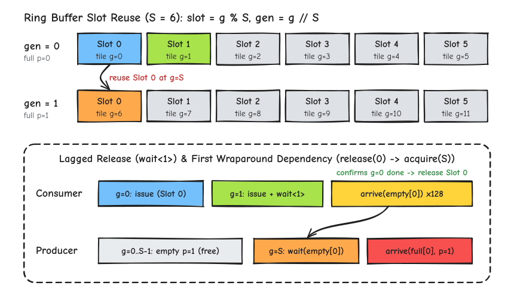
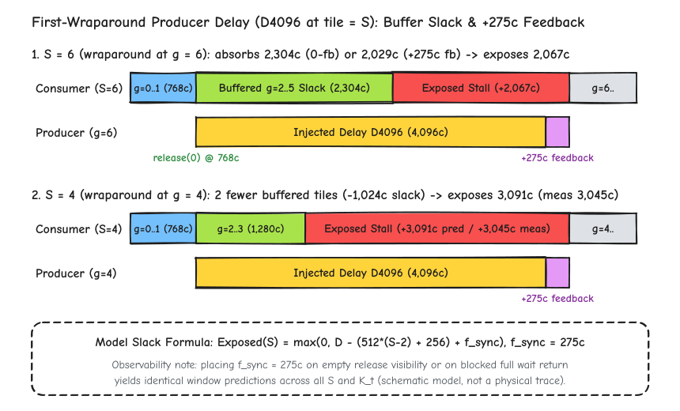
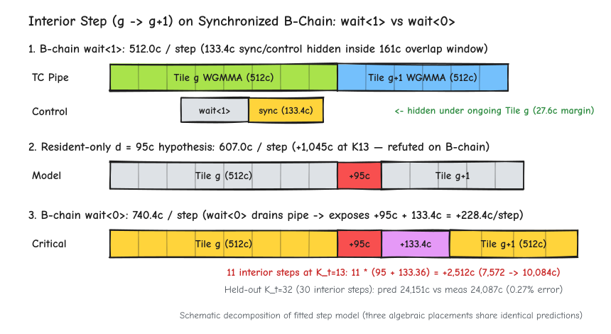

# Stage 数何时影响性能：Hopper 单 CTA 环形流水线的槽位回绕与延迟暴露

[上一篇](01-hopper-single-cta-wgmma-mainloop.md)在**单 CTA、空载条件**下验证了两个结论：使用 `warpgroup_wait<1>()` 配合滞后 1 拍的槽位释放，可将常驻共享内存的 WGMMA 主循环增量斜率降至理论下界 `512.0 cycles / K-tile`；在此基础上接入 6 阶段（`S = 6`）单 CTA 原生 TMA 流水线后，$K_t = 4 \to 13$ 的窗口增长与常驻同步链仅相差 `1 cycle`。

这也引出了一个直接的流水线设计问题：**既然单 CTA 空载下 `S = 4` 与 `S = 6` 的测量窗口几乎相同（原生 TMA 链在 $K_t = 13$ 上分别为 `8,478` 与 `8,458 cycles`），多出来的流水线槽位究竟在什么时候起作用；反之，当主循环同步或供数延迟超出缓冲余量时，额外周期又是如何暴露到关键路径上的。**

本文继续在 GH200（`sm_90a`）单 CTA 受控环境下，使用带 `full/empty` `mbarrier` 同步的常驻交接探针（[`cfg_b_handoff_chain.cu`](../../../microbench/gh200_resource_campaign/access_rules/probes/cfg_b_handoff_chain.cu)，即上一篇中的 B 链）开展三组递进实验：

- **实验 1（零延迟基线 `D0`：供数超前时 `S = 4` 与 `S = 6` 的等价性）**：当 Producer 无附加延迟时，槽位在 Consumer 回绕复用前早已重新发布为 `full`；此时 `S = 4` 与 `S = 6` 在 $K_t = 13$ 上的窗口仅相差 `25 cycles`（`7,597` 对 `7,572 cycles`），$K_t = 13 \to 32$ 的增量斜率严格保持 `512.0 cycles / K-tile`；
- **实验 2（首次回绕注入延迟 `D4096`：Stage 缓冲余量与 `275 cycles` 同步反馈项）**：在首次槽位回绕（`tile = S`）处向 Producer 注入 `4,096 cycles` 延迟后，`S = 6` 比 `S = 4` 多缓冲 2 个 K-tile（`2 × 512 = 1,024 cycles`），从而少暴露约 `1,000 cycles` 的停顿；同时实测暴露量比零反馈理想模型固定高出 **`275 cycles`**，固定该参数后对留出条件 `S4/K13` 与 `S6/K32` 的外推误差分别为 `1.49%` 与 `0.29%`；
- **实验 3（带屏障主循环改用 `wait<0>`：被 `wait<1>` 隐藏的 `133.4 cycles / step` 同步控制开销）**：在带 `full/empty` 屏障的 B 链上将主循环 `wait<1>` 改为 `wait<0>`，在 `S6/K13`（11 个内部过渡步）上窗口并非仅增加上一篇常驻纯计算链的 $11 \times 95 = 1{,}045\text{ cycles}$，而是暴涨 **`+2,512 cycles`**（`7,572 → 10,084 cycles`）。原因在于 `wait<0>` 排空 Tensor Core 管线后，不仅暴露了 `95 cycles` 的完成滞后，还将原本隐藏在 `wait<1>` 重叠窗口内的 **`133.4 cycles / step`** 跨步屏障与循环控制指令一并推上了串行关键路径；固定该参数对留出条件 `S4/K13` 与 `S6/K32` 的预测误差分别为 `0.39%` 与 `0.27%`。

（本文实验范围限于单 CTA 局部同步与槽位回绕机制；多 CTA 并发下的 L2/HBM 带宽争用、矩阵行距对 TMA 阶段响应的影响不在本文范围内。）

---

## 环形缓冲槽位复用：代次（Generation）、相位翻转与回绕依赖

在固定分块 `bM × bN × bK = 128 × 128 × 64`（FP16 输入，FP32 累加）下，探针 [`cfg_b_handoff_chain.cu`](../../../microbench/gh200_resource_campaign/access_rules/probes/cfg_b_handoff_chain.cu) 在单 CTA 内配置 256 个线程（`tid < 128` 为 Consumer 计算 Warpgroup，`tid >= 128` 为 Producer Warpgroup，其中 `tid == 128` 负责信号到达；每线程 167 个寄存器）。共享内存物理分配 6 个槽位（共 `196,608 B`），由运行期参数 `stages`（$S \in \{4, 6\}$）控制实际参与环形轮转的槽位数。

对于第 $g \in \{0, 1, \dots, K_t - 1\}$ 个 K-tile，其对应的环形槽位索引与复用代次（Generation）分别为：

$$\text{slot}(g) = g \bmod S, \qquad \text{gen}(g) = \lfloor g / S \rfloor$$

每个槽位配有一对 `cutlass::arch::ClusterBarrier`：`full[slot]`（到达计数为 1，由 Producer 单线程触发）与 `empty[slot]`（到达计数为 128，由 Consumer Warpgroup 全体 128 个线程各自触发一次）。由于 `mbarrier` 在初始化时的硬件相位（Phase）为 `0`，每当到达计数凑满便在 `0` 与 `1` 之间翻转一次，Producer 与 Consumer 按代次奇偶性等待相反的相位：

1. **Consumer 等待 `full[slot]` 的相位为 $\text{gen}(g) \bmod 2$**：第 0 代（$g = 0 \dots S-1$）等待相位 `0` 完成，第 1 代（$g = S \dots 2S-1$）等待相位 `1` 完成；
2. **Producer 等待 `empty[slot]` 的相位为 $(\text{gen}(g) + 1) \bmod 2$**：第 0 代（$g < S$）查询相位 `1`，由于屏障初始仍处于相位 `0`（意味着“上一阶段相位 `1` 已完成”），`wait(empty[slot], 1)` 立即通过，无需等待 Consumer；从第 1 代（$g \ge S$，即首次回绕）开始，Producer 必须等待第 $g - S$ 步的 Consumer 凑齐 128 次 `empty[slot]` 到达，才能复用该槽位。

结合上一篇确立的 **`warpgroup_wait<1>()` 滞后 1 拍释放规则**，图 4 给出了 $S = 6$ 时的槽位映射与首次回绕（$g = S$）的依赖路径：



如图 4 底部虚线框所示，`Slot 0`（承载 $g = 0$）并不会在 $g = 0$（Prologue）结束时释放，而是在 **$g = 1$ 的 `warpgroup_wait<1>()` 返回之后**才由 Consumer 触发 128 次 `arrive(empty[0])` 释放。对应的核心探针逻辑如下：

```cpp
// 节选并整理自 microbench/gh200_resource_campaign/access_rules/probes/cfg_b_handoff_chain.cu
// 计时窗口开始前：初始化 SMEM 数据，并预发布前 init_tiles = min(S, ktiles) 个槽位 (gen = 0)
if (tid == 0) {
  for (int tile = 0; tile < init_tiles; ++tile) {
    shared.generation[tile] = 0;
    Barrier::arrive(full + tile, 0, 1);           // 预发布 gen = 0 的 full[0 .. S-1]
  }
}
__syncthreads();
if (tid == 0) record.begin = clocks();            // 读取起始 %clock64
__syncthreads();                                  // 计时窗口内的起始会合

if (tid >= 128) {
  // Producer WG：从首个需要回绕复用的 tile = S 开始推进
  if (tid == 128) {
    for (int tile = init_tiles; tile < ktiles; ++tile) {
      int slot = tile % S;
      int gen  = tile / S;
      int empty_phase = (gen + 1) & 1;            // gen = 1 等待 empty 相位 0 完成
      while (!Barrier::try_wait(empty + slot, empty_phase)) {
        Barrier::wait(empty + slot, empty_phase); // 等待 Consumer 释放 tile - S 占用的槽位
      }
      if (delay_cycles > 0 && tile == S) {
        busy_wait_cycles(delay_cycles);           // 可选：在首次回绕 (tile == S) 注入受控延迟
      }
      shared.generation[slot] = gen;
      Barrier::arrive(full + slot, 0, 1);         // 发布新一代 full[slot]
    }
  }
} else {
  // Consumer WG (128 线程)：Prologue (tile 0) + Mainloop (tile 1 .. ktiles-1) + mma_tail
  wait_full(full, /*slot=*/0, /*phase=*/0);
  warpgroup_arrive();
  issue_tile_8x_wgmma(shared, /*slot=*/0, /*is_first=*/true, d);
  warpgroup_commit_batch();

  for (int tile = 1; tile < ktiles; ++tile) {
    int slot = tile % S;
    int prev_slot = (tile - 1) % S;
    wait_full(full, slot, (tile / S) & 1);        // 等待当前槽位 full 就绪
    warpgroup_arrive();
    issue_tile_8x_wgmma(shared, slot, /*is_first=*/false, d);
    warpgroup_commit_batch();

    warpgroup_wait<1>();                          // 确认上一组 (tile - 1) 已完成
    Barrier::arrive(empty + prev_slot, 0, 1);     // 128 线程释放上一槽位 prev_slot
  }
  warpgroup_wait<0>();                            // mma_tail：排空最后一组
  Barrier::arrive(empty + ((ktiles - 1) % S), 0, 1);
}
```

---

## 实验 1：零延迟基线（`D0`）——为何供数超前时 `S = 4` 与 `S = 6` 表现相同

首先考察不注入任何 Producer 延迟（`delay_cycles = 0`，记为 `D0`）的基线情况。由于前 $S$ 个槽位在进入计时窗口前已经就绪，且一旦 Consumer 在第 $g - S + 1$ 步末尾释放 `empty[slot]`，Producer 立即在数个周期内完成 `full[slot]` 的重发布，因此当 Consumer 推进到第 $g$ 步查询 `full[slot]` 时，该槽位早已处于 `ready` 状态。

在 GH200 上对 $S \in \{4, 6\}$、$K_t \in \{4, 13, 32\}$ 的实测中位周期如下：

| 配置（`Stages / K-tiles`） | 槽位回绕次数 ($\max(0, K_t - S)$) | `D0` 实测中位周期 | 冻结模型预测周期 | 相邻长度增长 / 阶段差 |
|---|---:|---:|---:|---|
| `S6 / K4` (`D0`) | `0`（无回绕） | `2,990` | `2,964` | 基准窗口（含起止会合与同步常数） |
| `S6 / K13` (`D0`) | `7`（`tile 6..12`） | **`7,572`** | `7,572` | 相对 `K4` 增长 `4,582c`（`509.1c / tile`） |
| `S4 / K13` (`D0`) | `9`（`tile 4..12`） | **`7,597`** | `7,572` | 相对 `S6/K13` 仅差 **`+25 cycles`**（`+0.33%`） |
| `S6 / K32` (`D0`) | `26`（`tile 6..31`） | **`17,300`** | `17,300` | 相对 `S6/K13` 增长 `9,728c`（**`512.0c / tile`**） |

这组基线数据说明了两个事实：
1. **在长归约区间 $K_t = 13 \to 32$ 上，带屏障同步的常驻链增量斜率精确回到 `512.0 cycles / K-tile`**：`S6/K32` 与 `S6/K13` 相差 $17{,}300 - 7{,}572 = 9{,}728\text{ cycles}$，除以新增的 19 个 K-tile 恰好为 **`512.0 cycles / K-tile`**。这表明在 `wait<1>` 与供数超前的条件下，每轮新增的 `full` 检查与 `empty` 到达指令完全隐藏在 Tensor Core 的计算进程之下，没有抬高稳态步长。
2. **当 Producer 供数始终快于 Consumer 消费时，增加 Stage 数不会缩短主循环耗时**：在 $K_t = 13$ 上，将环形槽位数从 `S = 6`（回绕 7 次）减至 `S = 4`（回绕 9 次），实测窗口仅从 `7,572` 变为 `7,597 cycles`（相差 `+25 cycles`，与上一篇单 CTA 原生 TMA D 链上 `S4` 对 `S6` 的 `+20 / +23 cycles` 差异一致）。只要 Producer 重填槽位的耗时短于环形缓冲提供的周转余量，`wait_full` 在软件侧始终命中已就绪屏障（`ready`），多出来的槽位只是处于空闲等待消费的状态。

---

## 实验 2：首次回绕注入延迟（`D4096`）——缓冲余量算术与 `275 cycles` 同步反馈项

要让 Stage 数 $S$ 产生可观测的性能分化，必须让槽位重填耗时超过环形缓冲所能吸收的周转余量（Slack）。为此，我们在**首次回绕步 `tile == S`**（`S = 6` 时为 `tile 6`，`S = 4` 时为 `tile 4`，二者复用的都是 `Slot 0`）的 Producer 完成 `wait(empty[0])` 之后、发布新一代 `full[0]` 之前，注入固定的忙等延迟 `delay_cycles = 4096`（记为 `D4096`）。

### 1. 环形缓冲余量（Buffer Slack）的理想算术关系

我们先在“零同步反馈延迟”（即假设 Consumer 释放 `empty[0]` 与 Producer 发布 `full[0]` 均瞬时可见）的理想模型下，计算 $S$ 个槽位能够吸收多少 Producer 延迟：

- **起点（`Slot 0` 何时被释放）**：Consumer 在 $g = 0$ 提交首组，在 $g = 1$ 提交第二组并执行 `warpgroup_wait<1>()`。在基准时间线模型中（每组计算服务 `512 cycles`，提交领先量 `256 cycles`），$g = 1$ 的 `wait<1>()` 在局部时刻 $t_{\text{release}(0)} = 256 + 512 = \mathbf{768\text{ cycles}}$ 返回并释放 `empty[0]`；
- **终点（`Slot 0` 何时被第 1 代再次需要）**：Consumer 依次处理已预填的 $g = 0, 1, \dots, S-1$ 共 $S$ 个 K-tile，其对应的 Tensor Core 计算管线可持续运转至局部时刻 $t_{\text{need}(S)} = 512 \cdot S$（在提交时间线上，对应第 $S$ 组的理想就绪时刻 $256 + 512 \cdot (S - 1)$）；
- **可吸收的缓冲余量 $\text{Slack}_0(S)$**：从 `768 cycles` 释放 `Slot 0` 到 `512 · S` 管线断流之间，环形缓冲中其余 $S - 2$ 个已就绪槽位（$g = 2 \dots S-1$）仍在供 Consumer 消费，因此理想可吸收延迟为：

$$\text{Slack}_0(S) = 512 \cdot S - 768 = 512 \cdot (S - 2) + 256\text{ cycles}$$

代入 $S = 6$ 与 $S = 4$ 可得：
- 当 **`S = 6`** 时：缓冲中有 $g = 2, 3, 4, 5$ 共 4 个完整 K-tile，可吸收 $\text{Slack}_0(6) = 512 \times 4 + 256 = \mathbf{2{,}304\text{ cycles}}$。注入 `D = 4,096 cycles` 后，零反馈模型预计暴露到总窗口上的停顿为 $4{,}096 - 2{,}304 = \mathbf{1{,}792\text{ cycles}}$；
- 当 **`S = 4`** 时：缓冲中仅有 $g = 2, 3$ 共 2 个完整 K-tile，可吸收余量减少 $2 \times 512 = 1{,}024\text{ cycles}$，降至 $\text{Slack}_0(4) = 512 \times 2 + 256 = \mathbf{1{,}280\text{ cycles}}$。注入同样的 `D = 4,096 cycles` 后，零反馈模型预计暴露的停顿增至 $4{,}096 - 1{,}280 = \mathbf{2{,}816\text{ cycles}}$。

### 2. 实测验证与 `275 cycles` 同步反馈参数

将上述零反馈预测与 GH200 实测的 `D4096 - D0` 窗口增量对比，结果如下：



| 配置与指标 | `D0` 实测 | `D4096` 实测 | 实测暴露增量 (`D4096 − D0`) | 零反馈模型预测增量 (误差) | 含反馈模型冻结预测增量 (`+275c`) (误差) | 含反馈总窗口预测 (误差) |
|---|---:|---:|---:|---:|---:|---:|
| **`S6 / K13`**（标定点） | `7,572` | `9,639` | **`+2,067`** | `+1,792` (`15.35%`) | **`+2,067`** (`0.00%`) | `9,639` (`0.00%`) |
| **`S4 / K13`**（留出跨 Stage） | `7,597` | `10,642` | **`+3,045`** | `+2,816` (`8.13%`) | **`+3,091`** (**`1.49%`**) | `10,663` (**`0.20%`**) |
| **`S6 / K32`**（留出长链） | `17,300` | `19,373` | **`+2,073`** | `+1,792` (`15.68%`) | **`+2,067`** (**`0.29%`**) | `19,367` (**`0.03%`**) |

从表中可以看到两个清晰的定量结果：
1. **Stage 数每减少 2 级，首次回绕延迟暴露量实测增加约 `1,000 cycles`**：在 $K_t = 13$ 上，同为注入 `4,096 cycles` 延迟，`S = 6` 仅向总窗口暴露 `+2,067 cycles`（吸收了约一半延迟），而 `S = 4` 暴露了 `+3,045 cycles`（两者相差 **`978 cycles`**，与理想模型中减少 2 个缓冲槽位损失 `2 × 512 = 1,024 cycles` 余量的斜率高度吻合）。这直接验证了多级 Stage 的核心作用：**每增加 1 个有效流水线槽位，本质上是在回绕依赖环路（`release(g - S) → acquire(g)`）上增加 `512 cycles`（1 个 K-tile 计算时间）的延迟吸收余量**。
2. **零反馈模型系统性低估暴露量 `275 cycles`，引入单参数同步反馈项 $f_{\text{sync}} = 275\text{ cycles}$ 后跨 Stage 与跨长度留出误差均低于 `1.5%`**：在标定点 `S6/K13` 上，实测增量 `2,067 cycles` 比零反馈预测 `1,792 cycles` 多暴露了 $2{,}067 - 1{,}792 = \mathbf{275\text{ cycles}}$。这意味着在受阻塞的回绕环路上，除纯计算周期外，还存在约 `275 cycles` 的跨 Warpgroup 同步传递与唤醒损耗，使有效缓冲余量从 $\text{Slack}_0(S)$ 缩减为 $\text{Slack}_0(S) - f_{\text{sync}}$：

$$\Delta T_{\text{exposed}}(S, D) = \max\!\big(0,\; D - \left[512 \cdot (S - 2) + 256\right] + f_{\text{sync}}\big), \qquad f_{\text{sync}} = 275\text{ cycles}$$

保持 $f_{\text{sync}} = 275\text{ cycles}$ 冻结不变（不重新拟合），直接预测留出条件 `S4/K13` 与 `S6/K32`，暴露增量预测值分别为 `3,091` 与 `2,067 cycles`，与实测值（`3,045` 与 `2,073 cycles`）的相对误差分别仅为 **`1.49%`** 与 **`0.29%`**（总窗口预测误差分别为 **`0.20%`** 与 **`0.03%`**）。

### 3. `275 cycles` 同步反馈项的观察边界与适用范围

在使用 $f_{\text{sync}} = 275\text{ cycles}$ 时，有两条明确的边界需要说明：
- **代数位置等价性（不可仅凭总窗口拆分为 `empty` 侧或 `full` 侧）**：在回绕环路 `Consumer arrive(empty) → Producer wait(empty) → D4096 → Producer arrive(full) → Consumer wait(full)` 中，无论将这 `275 cycles` 记在 **`empty` 释放可见性延迟**（Consumer 释放后经过 `275c` Producer 才从 `wait(empty)` 返回）上，还是记在 **受阻塞 `full` 等待的唤醒返回延迟**（Producer 到达 `full` 后经过 `275c` 被阻塞的 Consumer 才从 `wait(full)` 返回）上，两条公式在全部已测的 7 个窗口与 4 个差分响应上给出的预测值**逐点恒等**。因此，总窗口测量只能确定回绕环路上的净反馈损耗为 `275 cycles`，不能单独甄别其在 `empty` 与 `full` 两侧的物理分配比例。
- **不直接外推至多 CTA 满载 GEMM**：在后续完整多 CTA GEMM 核的阶段响应测试中，如果机械地对每一次受阻塞的 `full` 等待都叠加 `275 cycles` 本地唤醒惩罚，会把 `S = 4` 相对 `S = 6` 的整核性能退化高估至 `18.3%`（实测为 `10.5%`）。因此，$f_{\text{sync}} = 275\text{ cycles}$ 仅作为单 CTA 局部同步链的受控参数，不直接作为多 CTA 并发流水线的通用每步常数。

---

## 实验 3：带屏障主循环改用 `wait<0>`——被隐藏的 `133.4 cycles / step` 同步控制开销

在[上一篇](01-hopper-single-cta-wgmma-mainloop.md)的不含 `mbarrier` 常驻纯计算链（A 链）中，将主循环的 `warpgroup_wait<1>()` 改为 `warpgroup_wait<0>()` 会使每步多暴露 $d = 95\text{ cycles}$（单步斜率从 `512.0` 变为 `607.0 cycles / K-tile`）。如果我们在带有 `full/empty` 屏障同步的常驻 B 链（[`cfg_b_handoff_chain.cu`](../../../microbench/gh200_resource_campaign/access_rules/probes/cfg_b_handoff_chain.cu)）上做完全相同的单点修改——保持 167 个寄存器、循环结构及屏障指令完全不变，仅将主循环内 `DEPBAR.LE SB0` 的立即数从 `0x1` 改为 `0x0`——窗口周期会增加多少。

在 `S6/K13`（$K_t = 13$）中，除首组 $g = 0$（Prologue 无主循环 `wait`）和末组 $g = 12$（本来就要紧接 `mma_tail` 的 `wait<0>`）外，共有 **$K_t - 2 = 11$ 个内部过渡步**（$g = 1 \dots 11$）受主循环等待模式切换的影响：
- 若假设无排空滞后（$d = 0$），`wait<0>` 窗口应与 `wait<1>` 相同，保持 `7,572 cycles`（增量 `0 cycles`）；
- 若假设仅暴露上一篇纯计算链标定的 $d = 95\text{ cycles}$，则 11 个内部步应增加 $11 \times 95 = \mathbf{1{,}045\text{ cycles}}$，窗口预计为 $7{,}572 + 1{,}045 = \mathbf{8{,}617\text{ cycles}}$。

然而，GH200 实测 `S6/K13` 在 `wait<0>` 下的中位窗口达到了 **`10,084 cycles`**，比 `wait<1>` 的 `7,572 cycles` 整整增加了 **`+2,512 cycles`**（平均每个内部过渡步增加 $2{,}512 / 11 = \mathbf{228.36\text{ cycles}}$），直接否定了上述两个假设。

### 1. 为什么带屏障主循环在 `wait<0>` 下每步多暴露 `228.4 cycles` 而非 `95 cycles`

检查 SASS 控制流可以清楚看到：在主循环第 $g$ 步的 `DEPBAR.LE SB0` 返回之后、第 $g+1$ 步发射第一条 `HGMMA` 之前，Consumer Warpgroup 必须依次执行一串跨步同步与控制指令：
1. 对上一槽位执行 `SYNCS.ARRIVE`（释放 `empty[prev_slot]`）；
2. 更新循环游标并执行条件跳转 `BRA`；
3. 对下一槽位执行 `SYNCS.PHASECHK.TRANS64.TRYWAIT`（检查 `full[next_slot]`）；
4. 执行 `LDS` 读取 `shared.generation[next_slot]` 并校验代次；
5. 执行 `WARPGROUP.ARRIVE`（`wgmma.fence.sync.aligned`）准备下一轮发射。

图 6 对比了这串跨步同步与控制指令在 `wait<1>` 与 `wait<0>` 下的位置关系：



- **在 `wait<1>` 下（图 6 第 1 行）**：`DEPBAR.LE SB0, 0x1` 在确认第 $g-1$ 组完成时即返回，此时第 $g$ 组的 8 条 WGMMA 仍在 Tensor Core 管线中执行（按基准模型，距离下一组必须提交以维持 `512c` 满载还有 $256 - 95 = \mathbf{161\text{ cycles}}$ 的重叠窗口）。上述 **`133.36 cycles`**（$1{,}467 / 11$）的跨步屏障与控制指令恰好落在这 `161 cycles` 的重叠窗口内执行（尚余 `27.64 cycles` 的隐藏裕度），因此在 `wait<1>` 下完全不占用关键路径，增量斜率得以保持 `512.0 cycles / K-tile`；
- **在 `wait<0>` 下（图 6 第 3 行）**：`DEPBAR.LE SB0, 0x0` 阻塞至第 $g$ 组 WGMMA 完全排空才返回，不仅直接暴露了 **`+95.0 cycles`** 的排空滞后，而且由于此时 Tensor Core 管线已经空置，紧随其后的 **`+133.36 cycles`** 跨步同步与控制指令失去了重叠掩护，全部串行暴露在两批 WGMMA 之间：

$$\Delta_{\text{interior}}(\text{wait0}) = d + c_{\text{ctrl}} = 95 + 133.3636 = \mathbf{228.3636\text{ cycles / step}}$$

由此得到带屏障常驻链在 `wait<0>` 下的单步增量斜率为：

$$512 + 95 + 133.3636 = \mathbf{740.3636\text{ cycles / K-tile}}$$

### 2. 跨 Stage 与长链留出验证（`S4/K13` 与 `S6/K32`）

用 `S6/K13` 标定 $c_{\text{ctrl}} = 1{,}467 / 11 \approx 133.3636\text{ cycles}$ 后，保持全部参数冻结，直接外推留出条件 `S4/K13`（同为 11 个内部步，测试 `wait<0>` 是否改变无延迟下的 Stage 敏感性）与 `S6/K32`（30 个内部步，测试长归约步数下的线性累积），实测对比如下：

| 配置与指标 | 内部过渡步数 ($K_t - 2$) | `wait<1>` (`D0`) 实测 | 仅按 $d=95\text{c}$ 预测 `wait<0>` (误差) | 含暴露控制项 (`+228.4c/步`) 冻结预测 | `wait<0>` (`D0`) 实测中位周期 | 冻结模型相对误差 |
|---|---:|---:|---:|---:|---:|---:|
| **`S6 / K13`**（标定点） | `11` | `7,572` | `8,617` (`14.55%`) | `10,084.0` | **`10,084`** | `0.00%` |
| **`S4 / K13`**（留出跨 Stage） | `11` | `7,597` | `8,617` (`14.88%`) | **`10,084.0`** | **`10,123`** | **`0.39%`** |
| **`S6 / K32`**（留出长链） | `30` | `17,300` | `20,150` (`16.34%`) | **`24,150.9`** | **`24,087`** | **`0.27%`** |
| **`K13 → K32` 增长**（19 步） | `+19` | `9,728` (`512.0c/步`) | `11,533` (`607.0c/步`) | **`14,066.9`** (`740.4c/步`) | **`14,003`** (**`737.0c/步`**) | **`0.46%`** |

留出验证清晰地确认了两点：
1. **在 $K_t = 32$ 长链上，含暴露控制项的冻结模型将预测误差从 `16.34%` 压低至 `0.27%`**：从 $K_t = 13$ 到 $K_t = 32$（新增 19 个内部过渡步），实测窗口增长 $24{,}087 - 10{,}084 = 14{,}003\text{ cycles}$（合 **`737.0 cycles / K-tile`**），与冻结模型预测的 $19 \times 740.3636 = 14{,}066.9\text{ cycles}$ 仅差 `63.9 cycles`（`0.46%`）。这证明在带屏障的主循环中，`warpgroup_wait<1>()` 的收益远不止隐去 `95 cycles` 的尾部完成滞后——它同时为每步约 `133.4 cycles` 的 `mbarrier` 释放、轮询与发射前栅栏提供了必要的异步重叠窗口（合计每步节省 **`228.4 cycles`**）。
2. **代数分解边界说明**：在数学形式上，将这 `228.36 cycles / step` 拆写为“纯计算排空滞后 $d = 95\text{c}$ + 消费者推进控制 $c_{\text{ctrl}} = 133.36\text{c}$（记在 `consumer_advance` 或 `full_ready_return` 上）”，或者合并记为单一的“带同步主循环条件完成项 `228.36c`”，三种参数化方式在所有 $(S, K_t)$ 测试点上的窗口预测值完全一致。上文采用 $95 + 133.36$ 的分解是为了与上一篇纯计算 A 链的 $d = 95\text{ cycles}$ 保持跨实验一致，而非单凭 B 链总窗口独立分离出两个物理阶段。

---

## 总结：单 CTA 同步与槽位回绕实验总览

| 实验场景 | 核心配置对比 | 实测关键数值 | 冻结模型预测 (相对误差) | 核心机制结论（单 CTA 范围） |
|---|---|---|---|---|
| **1. 零延迟基线 (`D0`)** | `S4/K13` vs `S6/K13`<br>`S6/K13 → K32` (`wait<1>`) | `7,597` vs `7,572` (`+25c`)<br>增长 `9,728c` (**`512.0c/tile`**) | `7,572` (`0.33%`)<br>`9,728` (`0.00%`) | 供数超前时 `full` 始终就绪，增加 Stage 数不缩短耗时；稳态步长保持 `512.0c` |
| **2. 首次回绕延迟 (`D4096`)** | 在 `tile = S` 注入 `4,096c`<br>`S6/K13` vs `S4/K13` vs `S6/K32` | 暴露增量：<br>`S6/K13`: **`+2,067c`**<br>`S4/K13`: **`+3,045c`**<br>`S6/K32`: **`+2,073c`** | 含 $f_{\text{sync}}=275\text{c}$：<br>`+2,067c` (标定)<br>`+3,091c` (**`1.49%`**)<br>`+2,067c` (**`0.29%`**) | 每多 1 个 Stage 在回绕环路上多提供 `512c` 延迟吸收余量；受阻塞环路含 `275c` 净同步反馈损耗 |
| **3. 同步链主循环 `wait<0>`** | B 链 `wait<1>` → `wait<0>`<br>`S6/K13`、`S4/K13`、`S6/K32` | 总窗口 / 步长：<br>`S6/K13`: **`10,084c`** (`+2,512c`)<br>`S4/K13`: **`10,123c`**<br>`S6/K32`: **`24,087c`** (**`737.0c/tile`**) | 含 $+228.4\text{c/步}$：<br>`10,084.0c` (标定)<br>`10,084.0c` (**`0.39%`**)<br>`24,150.9c` (**`0.27%`**) | `wait<1>` 不仅隐去 `95c` 排空滞后，还将每步 `133.4c` 的屏障与循环控制隐藏在重叠窗口内 |

---

## 参考源码与实验入口

- **仓库探针与模型文档**：
  1. **单 CTA 局部同步与槽位回绕实验主文档**：[Q04 局部同步链实验页](../gemm/experiments/gh200_sm90/Q04-sync-slot/local-sync-chain.md)、[同步服务硬件规则 `SYNC-SERVICE.md`](../gemm/model/mechanism/hardware_rules/SYNC-SERVICE.md)；
  2. **常驻同步交接微基准探针**：CUDA 探针源码 [`cfg_b_handoff_chain.cu`](../../../microbench/gh200_resource_campaign/access_rules/probes/cfg_b_handoff_chain.cu)、构建与运行驱动 [`cfg_b_handoff_chain.py`](../../../microbench/gh200_resource_campaign/access_rules/cfg_b_handoff_chain.py)；
  3. **本地实验结果归档**（`results/gh200_resource_campaign/access_rules/Q04-sync-slot/local-sync-chain/` 下）：
     - 首次回绕延迟响应与 `275 cycles` 反馈参数标定/留出验证：`20261018-Q04-local-handoff-001`、`20261018-Q04-native-feedback-001`、`20261018-Q04-compute-feedback-connection-001`；
     - 带屏障主循环 `wait<0>` 证伪与 `133.4 cycles` 暴露控制项留出验证：`20261018-Q04-native-compute-wait-001`、`20261018-Q04-exposed-control-001`、`20261018-Q04-exposed-control-002`；
     - 多 CTA 阶段响应范围边界复核：`results/gh200_resource_campaign/access_rules/Q03-stage-supply/stage-response/20261018-Q03-feedback-transfer-001`。

`results/` 目录不在 git 中，上述归档路径只在本地仓库可用。
