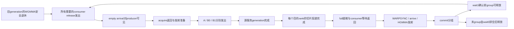

# R13：有效供给、阶段与可辨识性

当前供给尚未通过V09迁移。[联合初态对照](#second-prefill)使stage4早段十对均缩短，但从预等之前到C16/M的累计时间并未稳定缩短，不能由短窗口提高服务率。恒定reduced复用关系已有反例；放宽提交/退休分支后，关闭处理的窗口虽可拟合到0.28% RMS，遗漏的局部等待仍有大误差，也未预测出开启处理的早段变化。两种候选均不采用，不能将训练窗口的小残差当作规则成立。

首次供给的释放前端点使新批40/40次ready观察能绑定首代事务，排除了本协议下“只是consumer晚返回”；请求排队、数据服务与就绪可见性仍未分开。逻辑源请求与填零量不等于物理流量。现行公式只在[RULES](RULES.md#v09-model)维护；行距证据见[R10](R10-layout-cache.md)，边界/填零证据见[R18](R18-cluster-boundary.md)。

## 作业与分析索引

| 证据 | 条件与作用 | 可复核入口 |
|---|---|---|
| R05-D，735059 | 立即释放消费者，stage 2/4；共享小源与独立大源 | [正式报告](../../../../../../results/gh200_resource_campaign/access_rules/20261006-c-job735059/r05-formal-v2/report.md) |
| R13，735876/735985/736169 | 18 条件的 plain 服务率、ready/retire/reuse 事件对 | [ready](../../../../../../results/gh200_resource_campaign/access_rules/20261007-R13-job735876-v8-formal-ready-review-B/report.md)、[ready 补查](../../../../../../results/gh200_resource_campaign/access_rules/20261007-R13-job735985-v9-ready-recheck-review-B/report.md)、[retire](../../../../../../results/gh200_resource_campaign/access_rules/20261007-R13-job735985-v9-formal-retire-review-B/report.md)、[reuse](../../../../../../results/gh200_resource_campaign/access_rules/20261007-R13-job736169-v11-formal-reuse-review-B/report.md) |
| V08F，737322 | 51 条后续窗口拟合；14 条尾部/D 行距诊断 | [候选与留组结果](../../../../../../results/gh200_resource_campaign/access_rules/20261008-V08F-job737322-v1/reanalysis/A-20261009-supply-v3/summary.json) |
| SM 扫描，738101 | cfg_a 四档 grid、三个 pitch，固定 K4096 | [软件波次](../../../../../../results/gh200_resource_campaign/access_rules/20261009-R13-sm-job738101/reanalysis/shared-cap-candidates-v3/summary.json)、[有限预填](../../../../../../results/gh200_resource_campaign/access_rules/20261009-R13-sm-job738101/reanalysis/prefill-cap-candidates-v1/summary.json) |
| 同卡 B13，738203/738296/738307 | B 行距和 A/B source-map 共 13 条件，供给与填零组合开发 | [需求/填零候选](../../../../../../results/gh200_resource_campaign/access_rules/20261009-R10-b-coverage-job738203/reanalysis/A-20261009-valid-fill-v4/summary.json)、[CTA 组合](../../../../../../results/gh200_resource_campaign/access_rules/20261009-R10-b-coverage-job738203/reanalysis/A-20261009-cta-composition-v3/summary.json) |
| 三配置，738496 | 29 条件的 first/later 定值；cfg_b 后与旧 B13 有条件联合 | [phase 模型](../../../../../../results/gh200_resource_campaign/access_rules/20261009-R13-R15-R18-composition-job738496/reanalysis/A-20261009-phase-supply-v1/models.json)、[cfg_b 联合报告](../../../../../../results/gh200_resource_campaign/access_rules/20261009-R13-R15-R18-composition-job738496/reanalysis/A-20261009-b-joint-supply-v1/summary.json) |
| 首轮填零，738707/738865 | 只补 A/C first；六组训练行与拒绝范围 | [模型](../../../../../../results/gh200_resource_campaign/access_rules/20261009-R13-R15-R18-composition-job738496/reanalysis/A-20261009-first-fill-merged-v1/models.json)、[验证](../../../../../../results/gh200_resource_campaign/access_rules/20261009-R13-R15-R18-composition-job738496/reanalysis/A-20261009-first-fill-merged-v1/verification.json)、[支持定位](../../../../../../results/gh200_resource_campaign/access_rules/20261009-R13-R15-R18-composition-job738496/reanalysis/A-20261009-first-fill-merged-v1/support-diagnosis.json) |
| V09，739011 | 冻结后的新几何、行距和 stage 迁移 | [完整留出与判定](V09-component-validation.md) |
| stage×K，739095 | 同卡四条件；固定启动差和恒定每Ktile罚项均不充分 | [成对窗口、协议扰动与缩放残差](../../../../../../results/gh200_resource_campaign/access_rules/20261009-V09-heldout-job739011/reanalysis/failure-decomposition-v1/B-controls.json) |
| 同次stage事件，739556 | CTA0第二输出Ktile16；额外L在mma返回前，局部等待与发射区间互相转移 | [窗口与累计进度](../../../../../../results/gh200_resource_campaign/access_rules/20261009-V09-heldout-job739011/reanalysis/candidate-development-v1/B-stage-events.md) |
| consumer累计进度，739578 | 同几何stage4/6；相邻commit分解与早/后段累计差，区分循环推进和最终drain | [同次端点与递推对照](../../../../../../results/gh200_resource_campaign/access_rules/20261009-V09-heldout-job739011/reanalysis/candidate-development-v1/B-stage-progress.md) |
| 组内服务递推，离线 | 仅stage6三个局部量校准；独立局部约束的q剖面仍高估stage4，推导有限窗口下界 | [参数族与逐分项比较](../../../../../../results/gh200_resource_campaign/access_rules/20261009-V09-heldout-job739011/reanalysis/candidate-development-v1/B-stage-admission.md) |
| 交接不可辨识性，离线 | 不同ready/交接组合给出相同stage6局部量及L，却产生不同stage4响应 | [同调用下界与参数反例](../../../../../../results/gh200_resource_campaign/access_rules/20261009-V09-heldout-job739011/reanalysis/candidate-development-v1/B-stage-handoff.md) |
| 同次计算组交接，739686 | 原两stage×plain/progress/handoff；交接非零，stage差主要在首full等待，局部观察扰动明显 | [三段闭合与累计推进](../../../../../../results/gh200_resource_campaign/access_rules/20261009-V09-heldout-job739011/reanalysis/candidate-development-v1/B-stage-handoff-samples.md) |
| 固定入口，离线 | 旧延迟违反后段必要界；stage4必须有内部停顿，不能只移动入口或末端领先量 | [条件重放与参数无关界](../../../../../../results/gh200_resource_campaign/access_rules/20261009-V09-heldout-job739011/reanalysis/candidate-development-v1/B-stage-conditioned.md) |
| 共同复用组合，离线 | 有限窗口与任意单一producer间隙的条件界；宽分支须联立端点 | [中位区间与早段上界](../../../../../../results/gh200_resource_campaign/access_rules/20261009-V09-heldout-job739011/reanalysis/candidate-development-v1/B-stage-reuse.md)、[边界间隙与适用限制](../../../../../../results/gh200_resource_campaign/access_rules/20261009-V09-heldout-job739011/reanalysis/candidate-development-v1/B-stage-boundary.md)、[联合端点](../../../../../../results/gh200_resource_campaign/access_rules/20261009-V09-heldout-job739011/reanalysis/candidate-development-v1/B-stage-joint.md) |
| 前一输出顺序，739717 | 消除早段E0重叠后stage4早段缩短，完整继承子类仍有缺口 | [R15统一分析](R15-output-service.md#next-mainloop-overlap)、[逐进程结果](../../../../../../results/gh200_resource_campaign/access_rules/20261009-V09-heldout-job739011/reanalysis/candidate-development-v1/B-epilogue-order.md) |
| 输出背景，739740 | 固定CTA0处理、仅改变其它CTA首输出；stage4早段缩短、后段变长 | [R15统一分析](R15-output-service.md#stage-output-background)、[同调用背景与进程差](../../../../../../results/gh200_resource_campaign/access_rules/20261009-V09-heldout-job739011/reanalysis/candidate-development-v1/B-stage-background.md) |
| 第二WG初态，739790 | 仅CTA0预等S槽，stage4/6同binary开关；early与完整时间分列 | [同批配对与限制](#second-prefill)、[逐进程结果](../../../../../../results/gh200_resource_campaign/access_rules/20261009-V09-heldout-job739011/reanalysis/candidate-development-v1/B-second-prefill.md) |
| 背景基线，离线 | 区分早/后段输出相位；仅两个无E0覆盖窗口约束c/T，固定后迁移 | [条件范围与未定项](#stage-background-baseline)、[逐进程包络](../../../../../../results/gh200_resource_campaign/access_rules/20261009-V09-heldout-job739011/reanalysis/candidate-development-v1/B-stage-baseline.md) |
| 共享服务候选，离线 | 真实软件依赖自行生成E0；低窗口残差仍伴随相位/本地响应失败 | [候选边界](#stage-shared-service)、[拟合与全卡对照](../../../../../../results/gh200_resource_campaign/access_rules/20261009-V09-heldout-job739011/reanalysis/candidate-development-v1/B-stage-shared-service.md) |
| 首次供给，739629 | 同binary新增打点开关 × 起步0/512 ns × B0/B32；定位S增长 | [同批观察扰动与端点](../../../../../../results/gh200_resource_campaign/access_rules/20261009-V09-heldout-job739011/reanalysis/candidate-development-v1/R13-first-supply.md) |
| 独立ready，739645 | 只读phase0观察开关 × 起步0/512 ns × B0/B32；10/40可绑定、30/40边界跨FIRST | [观察扰动与区间](../../../../../../results/gh200_resource_campaign/access_rules/20261009-V09-heldout-job739011/reanalysis/candidate-development-v1/R13-ready-observer.md) |
| 释放界ready，739653 | 同四条件、同binary联合观察开关；40/40可绑定，ready前增长不能由consumer返回单独解释 | [逐进程区间与模型必要界](../../../../../../results/gh200_resource_campaign/access_rules/20261009-V09-heldout-job739011/reanalysis/candidate-development-v1/R13-ready-release.md) |

## 2026-10-11：统一工作账本与局部生命周期复核

本轮B先固定工作定义，未新增服务价格或GPU样本。纯接口 `supply_model.supply_work_ledger(row, setup)` 的版本为 `gh200-supply-work-ledger/1`；沿用 `static_tma_requests` 的完整Ktile、FP16 row-major、cfg_a/b/c、合法行距、源map与真实持久工作分配。每个源atom保留issuer CTA、输出序号、A/B身份、descriptor extent/stride、Ktile0的origin/shape、multicast mask及目的CTA；后续Ktile在K坐标加64。来源不是实测地址，源身份只在同一次调用内有效。rotation、工作交换和多份源分配明确拒绝，740033仍由专用入口复核。

| 账目 | 定义与单位 | 可以怎样使用 |
|---|---|---|
| `totals.source_payload_KiB` | 全部发出的descriptor box名义FP16 payload，包括box内OOB；全部Ktile与输出累加 | 旧时钟S的兼容工作口径；不能改名为有效读字节 |
| `source_valid_KiB`、`source_box_fill_KiB` | source box中有效地址与填零部分，分别累加 | 输入路径的独立候选工作量，不直接替换r2系数的输入 |
| `distinct_source_boxes`、`distinct_valid_source_KiB` | descriptor、operand、origin/shape一致的box去重，跨输出保留相同B源 | 静态身份集合；不声称重访命中、在途合并或真实读取次数 |
| `destination_atoms`、`destination_valid_KiB`、`destination_fill_KiB` | 每个multicast目的rank分别收取切片；每个目的操作数保留全部源atom前驱 | 目的SMEM投递与full依赖；不能随源共享删掉目的工作 |
| `output_nominal_KiB`、`output_valid_KiB`、`output_nominal_subtiles` | FP32 D的名义tile、逻辑有效面积与固定epilogue子tile格点 | 独立输出工作；不当作物理写流量或cooperative已验证的提交图 |

cfg_b第二WG对照的四条件账目相同：50688次输入请求、540672KiB目的投递、264个D tile/2112个8KiB名义子tile；去重源为2944个box/34816KiB有效地址。源共享只可能改变服务generation，不能减少目的或D工作。cfg_a每rank发本地A16KiB和B的两个4KiB box（各N64×K32×FP16），B投给两rank；每issuer的B共8KiB，每目的收到两issuer共四box/16KiB，加本地A后full payload为32KiB。cfg_c每rank发A的16KiB M切片并投给两rank，B两个8KiB box本地使用。例如cfg_c M192时两个issuer的A有效源为16/8KiB，每个目的A均为24KiB有效＋8KiB fill，机械平分成12/12错误。

`input_slot_state(g,S)`明确保留跨输出的全局K-group：slot=`g%S`、generation=`g//S`、consumer full等待phase=`generation%2`、producer empty等待phase=`(generation+1)%2`，复用前驱为g−S。phase是等待参数，不是观测到的barrier当前值。K4096、stage6第二输出从g=64开始，slot4/generation10；不能在输出边界重置到slot0。来源为快照CUTLASS `PipelineState`、`make_producer_start_state` 与pingpong consumer的两输出步进，不把MAIN戳等同于empty到达。

### 局部图必须分开的事件

图只给依赖，不给未识别的边成本。producer的等待前/后工作分别保留；commit不是TC执行开始，wait1返回不是当前group全部退休。cfg_b前WG在`mma()`返回后先到达math-order barrier，下一WG可开始，然后前WG才`mma_tail()`释放末slot；math次序与epilogue次序是两个depth。现有 `shared_stage_events` 仍把release发出/可见性合为一个事件，producer发射与consumer起动是零时长事件，统一gap不提供对称竞争。当前图修订没有给这些遗漏另拟常数，也没有宣称无成本并发成立。

cfg_a/c沿用以上工作账本，**不沿用cfg_b的两WG交替时间图**。B提供目的rank的源切片前驱，C提供本地producer arrival、跨rank full/empty token、两WG安全释放与arrival可见性；这些前驱接入后才能组合。首版接口不为cluster/CTA/SM/源组编号定价。

### 已有约束逐项结论

| 对象/窗口 | 通过或支持的部分 | 失败、排除与未分辨范围 |
|---|---|---|
| 57个静态条件 | 三配置、首轮fill、R10方向/规模和R13两stage的源切片到目的valid/fill、D有效面积守恒 | 只确认工作量；未验证时间价格 |
| 8个共享/不共享事件图 | 共1022098项依赖检查：三目的atom齐备、安全退休后释放、g−S复用、wait1/末wait0语义、严格订阅截止、D源buffer安全覆盖 | 只确认候选实现；release发出与可见性尚未分开 |
| 739095 first/later、stage×K | 全部八个窗口保留 | 固定启动差、恒定每Ktile罚项和旧stage/K折扣迁移均不充分 |
| 739556稀疏Ktile16与refill | 每调用L闭合；stage差在mma返回前累计 | full等待增量被随后commit段抵消；不能单点乘K或把6cycle wait当完整WGMMA延迟 |
| 739578 C1→16、C17→63、H17→C17 | 同调用相邻段闭合；stage4早、后段均有额外推进时间 | 零循环推进、旧2257.5cycle ready底值及现有共同常量修订失配；观察协议单列 |
| 739686 math交接与首full | receiver已到门口，stage差主要在首full；交接非零 | 局部观察扰动明显，不能拼旧协议价格或只移动FIRST解释全L |
| 739717仅本CTA E0延期 | stage4 early周期十对缩短 | 局部E0单向排他最大响应仍不足；不唯一识别端口 |
| 739740其它CTA E0延期 | stage4 early缩短、后段变长，按全部配对保留 | overlap数不能定价；同质FIFO不能解释空间排序与相位 |
| 739790 second-prefill | stage4 early十对缩短，stage6无同量级响应；prefix16/prefixM逐调用闭合 | 累计到C16/M并不稳定改善；reduced子类必要界在stage4十对均失败；宽分支低训练误差仍漏局部等待/干预 |
| 全CTA空间跨度与排序 | stage4组差在原生cycle中仍存在；源共享打破旧FIFO严格保序 | 当前共享/不共享参数四条件跨度均不足；观测PROD偏移不能补齐；不能让early改善抵消跨度失败 |
| 740033 A源轮换 | 首窗10/10有效；固定位置RMSE仅8/10优于地址对应 | 不支持稳定地址跟随，也未识别固定位置价格；740030/740032失败保留，不重跑 |
| ready/服务结束/服务开始订阅截止 | 三候选均保留全部目的工作 | 有界重拟均未同时修复early方向与跨度；不继续扫描截止 |
| defer2局部E0排他 | 三范围×两stage全部返回结果与关闭时相同 | 本CTA输入/MMA起动已完成才开始E0，无第一处受阻事件；任意增大局部E0费用均不能修复此结构缺口 |
| 739653 producer延迟与ready | 40/40绑定首代，issue→ready增量20/20严格为正 | 排除本协议“ready不变、只晚consumer返回”；排队/服务/通知可见性仍不可区分 |
| R10 B32方向/规模、基址/工作交换/producer延迟 | 同批方向与规模改变行距响应，固定位置改变起步也改变响应 | 固定覆盖价、面板价、位置价均不充分；旧/新B32现象同时保留，尚无可迁移时间规则 |

本轮专用入口为 `analyze_r13_lifecycle.py --data-root <主checkout结果根> --output <新的B独占目录>`。[复核结果](../../../../../../results/gh200_resource_campaign/access_rules/20261009-V09-heldout-job739011/reanalysis/B-20261011-lifecycle-v3/B-verification.json)核对34份交接哈希，精确重现旧候选/局部排他/轮换的13组结果；[账目](../../../../../../results/gh200_resource_campaign/access_rules/20261009-V09-heldout-job739011/reanalysis/B-20261011-lifecycle-v3/B-work-ledger-summary.json)与[全部已有窗口及干预](../../../../../../results/gh200_resource_campaign/access_rules/20261009-V09-heldout-job739011/reanalysis/B-20261011-lifecycle-v3/B-existing-constraints.json)保持原生cycle/ns。v1因遗漏历史参数默认值在审计阶段停止，失败说明保留；v2成功，v3补齐接口版本与拒绝范围后重放。旧报告、V09冻结/评分和正式参数不变。

下一轮先检验有限局部发射/消费/释放前驱与源ready的联合可行性，保留first/later和空间约束；没有两个明确解释给出现有证据无法区分的预测前，不申请补测。该里程碑没有独立冻结局部留出，持续目标未完成。

同一图的R10迁移现已完成一轮有界开发筛选，见[R10](R10-layout-cache.md#source-event-transfer)。原两输出默认保持不变；扩展仅接入每CTA实际输出次数、同WG accumulator须等E_(j−2)返回，以及显式的每源atom服务费用。用AlongM later一个响应定值B32覆盖价后，AlongN、single126首窗和空间分布仍明显失败，该价格点不采用。目的投递与D账目不随源覆盖价减少，未拟A16或stage4价格。

### cfg_a源atom与跨rank依赖的组合接口

`cfg_a_source_bindings(row, setup)`将统一账本按物理cluster与rank组织；`cfg_a_atomic_source_graph(rank_graph)`接收C的`cfg_a_rank_dependencies`完整图，细化输入请求与目的完成节点。两者均不读取观察时间或服务价格。图模板按stage、Ktiles与每rank输出数复用，具体源descriptor、origin、valid/fill及目的rank由静态绑定提供；global group=`j×Ktiles+local_K`，源K坐标增加`64×local_K`，跨输出不重置stage代数。

每个K-group两rank发六个源atom：两个本地A16KiB和四个组播B4KiB，共48KiB。组播后共有十次目的投递/64KiB；每个full保留本地producer arrival、本地A16KiB，以及两issuer各两个B4KiB完成前驱，总payload32KiB。C的`B_issue`是两个B atom发起后的汇合，`B_to_r`是两个4KiB目的完成后的汇合，不能再收一份传输费用。B0/B1各有源就绪与目的完成事件，可以在另一个box尚未发出时推进；本次没有SASS确认两者的相对发起次序，偏序图不额外加入该顺序。

[组合复核](../../../../../../results/gh200_resource_campaign/access_rules/20261010-R18-cluster-fill-discrimination/reanalysis/B-20261011-cfg-a-source-composition-v2/B-cfg-a-source-composition.json)覆盖三份已有归档的22个cfg_a条件、220个dual进程、28200个CTA，全部实际工作坐标与两WG工作列表一致；12种stage6、K1024/4096、每rank输出数1/2/3/4/7/8图模板无环，保留C的147284条原依赖边、全部release/empty arrival与输出节点。OOB填充、扩展map的显式零路径、D有效面积和四个名义子tile分别守恒。任意scheduler映射若跨越物理cluster/rank/输出序号则拒绝；已见`[132,1,1]` grid通过，任意多行AlongM grid不据此宣称支持。空闲cluster仅列明，不赋予生命周期时间。

入口为`analyze_cfg_a_supply.py --data-root <结果根> --c-model <只读C/output_model.py> --output <新B目录>`，保存源文件、case/setup、record/raw哈希与压缩后的绑定/完整图。v1加入了尚未由本次SASS确认的B0→B1顺序；v2删除该额外边并重新复核，v1保留。74项相关测试通过。以上仅确认结构接口及旧样本工作绑定，不证明源/目的服务价格、局部窗口、干预或空间时间分布；R10/V09失败结果不变，新的独立冻结局部留出仍未完成。

C增加输出source guarantee、`empty_emit_to_r`与`acquire_return`后，[v3组合复核](../../../../../../results/gh200_resource_campaign/access_rules/20261010-R18-cluster-fill-discrimination/reanalysis/B-20261011-cfg-a-source-composition-v3/B-cfg-a-source-composition.json)仍通过同一22条件/220进程；静态绑定压缩文件与v2逐字一致，12种图保留全部新增端点及输出保证。empty实际发出、目的可见和producer返回不再合为同一事件；这些仍是cfg_a接口，不能套用cfg_b的四warp leader观察。

## cfg_b的释放标记没有定位全部128次empty arrival

本轮继续离线复核739556全部20个同调用稀疏记录。kernel为cfg_b设置`num_consumers=NumThreadsPerWarpGroup=128`；cluster1的`PipelineTmaAsync`以128初始化empty arrival count，所有consumer线程均`is_signaling_thread=true`。Ktile17的wait1确认前group安全后，128线程各执行原`consumer_release`，释放Ktile16；原观察只给thread256打点，不能据该线程返回认定其它三个warp已经arrival。源码与SASS均属于同一归档，未拼接其它观察批次。

| 同SM原生cycle窗口 | stage4中位〔范围〕 | stage6中位〔范围〕 |
|---|---:|---:|
| thread256 release前→producer refill acquire后 | 232〔161,273〕 | 242〔146,249〕 |
| thread256 release后→producer refill acquire后 | 211〔141,253〕 | 220.5〔126,229〕 |
| thread256自身release前/后标记 | 20〔20,22〕 | 22〔20,23〕 |

20/20个producer在thread256 release前已开始等待同slot的下一代；真实slot/phase已由原replay验证。stage4为全局group80/slot0、producer等待phase1，stage6为group80/slot2、等待phase0；补发分别是group84/86。stage4 SASS的前clock/arrival/后clock为0x2190/0x21f0/0x2200，stage6为0x2220/0x2280/0x2290，clock只对目标线程执行。

把thread256实际emit取在其前后界内，令未观测的最后warp arrival为R、producer acquire后标记为A。两项非负量`R−leader_emit`与`A−R`只有和被约束。两组明确见证在20/20次均精确重现端点：一组令最后arrival之后为32cycle，其余是warp arrival分散；另一组令其它warp只比leader晚16cycle，其余在最后arrival之后。16/32只是非唯一性的诊断见证，不是硬件价格。后一项还包含arrival处理、empty可见性、轮询/调度、`arrive_and_expect_tx`和acquire后clock路径，不能命名为裸barrier延迟。这补齐了旧“release→复用非零”结论中的必要线程前驱。

最小新观察只在同样的stage4/6、同geometry和原slot上，为thread288/320/352补原arrival的clock64前后界；thread256原标记保留，同stage同binary用runtime开关比较leader-only与四warp观察。无需新增polling warp、named barrier、arrival或同步依赖。若全部四warp到达前/后分别为B/E，则最后emit位于`[max(B),min(max(E),A)]`，可保守分开arrival分散与最后emit之后的路径。各warp标记之后才producer返回不是必要条件，后clock可晚于已完成arrival。

[具体观察请求](../../../../../../results/gh200_resource_campaign/access_rules/20261010-R13-stage-events/reanalysis/B-20261011-release-prerequisites-v3/B-minimal-release-observation.json)预列两stage×开关×十进程、实际GPU-ef8692f3、完整D检查和全部窗口。64cycle是预定辨识尺度，依据旧20～23cycle release bracket及60～69cycle acquire→三输入发出窗口选择，不是全GEMM百分比或物理常数。四warp的arrival分散上界≤64支持集中arrival解释；最后emit→acquire后上界≤64支持晚arrival解释；对应下界>64则排除该近似，跨界或两者都大时保留未分辨/混合结果。观察有效性另检查每warp bracket≤32cycle、局部on/off绝对误差门槛及整调用扰动，不能用整调用合格代替局部检查。

该请求是开发辨识，不是新的独立冻结留出或参数验收。公共probe和GPU仅由主集成实施，并在采样前保存最终范围、端点、具体门槛与source/binary身份。本组没有提交GPU任务。[20次原始端点与见证](../../../../../../results/gh200_resource_campaign/access_rules/20261010-R13-stage-events/reanalysis/B-20261011-release-prerequisites-v3/B-release-prerequisites.json)由 `analyze_r13_release.py --run <739556归档> --output <新的B目录>`复放；输入记录/raw/source/SASS哈希全部保留。

### 四warp smoke保留了明显的局部观察差

主集成740054的正确性准备在GPU-43269fbc进行，每stage×开关各一次，未独占性能环境，未进入原GPU-ef的40进程研究。B直接复放四份原始gz、严格decoder和每进程4096个D抽样值；暖机按归档`run.sh`明确声明的`common-sw1-16`绑定，不将构建cases的默认adaptive身份移作实际命令。主线的全D检查与静态覆盖证据另行维护，不由本分析代替。

| stage | leader release前→acquire后的on−off，cycle | H16→wait1-return的on−off，cycle | CUDA event on/off变化 |
|---|---:|---:|---:|
| 4 | 0 | +368 | +1.5873% |
| 6 | +82 | −1 | +0.2566% |

stage4上游单对差超过原最大192cycle；stage6单对local差超过原中位32cycle。两者仅一对，不能由此判正式研究通过/失败，也不能唯一归因观察器；整调用差小不能替代局部门槛。主集成已在正式采样前明确中位口径为`median(abs(on−off))`，`abs(median(on−off))`只列诊断，避免正负抵消。其余门槛保持32/128cycle、64/192cycle和2%/5%。

两个开启记录的其它三个warp均在leader前发出arrival。条件于四warp bracket确实覆盖全部必要arrival，stage4的post-last-emit→acquire后区间为[209,232]cycle、warp-skew为[0,23]；stage6分别为[206,231]、[0,25]。按64cycle尺度，两次条件分类均排除“最后arrival之后很短”的近似，与arrival集中近似相容。但GPU、样本数和观察资格尚未满足，**不采用机制解释，也不定barrier或供给价格**。

[逐进程区间与门槛](../../../../../../results/gh200_resource_campaign/access_rules/20261010-R13-stage-events/reanalysis/B-20261011-release-warp-smoke-v2/B-release-warp-smoke.json)由专用`analyze_r13_release_interpretation.py`生成；纯`paired_observer_gates`保留缺失配对、SM/工作身份不符、宽bracket、最大单对超限及不足十次的原因。v1因将构建case当作smoke命令而被暖机身份检查拒绝；v2按两份一致的归档run.sh绑定，未修改旧case或raw。10项新增测试覆盖区间边界、混合/未分辨、符号抵消和失效保留，连同既有测试共84项通过。

## 第二WG的初态是否影响早段推进？

cfg_b 2816×1536×4096、132 CTA各做两个输出，全部首输出E0仍等自身第二MMA返回。仅CTA0第二WG在原prologue前，以read-state副本预等最初S槽（stage4或6），不释放槽、不推进真实read state。最后一个新槽依赖前WG tail释放，因此处理同时保证初始S槽ready和前WG排空，并推迟消费相位；它不是纯输入填充对照。SASS确认4/6次等待及原状态重读，40个progress记录的waited均与开关一致，暖机处理均关闭。

739790在a058的GPU-ef8692f3上完成；每格plain/progress各十个有效独立进程，另20个先行参照。下表为同stage、同binary、同trial的开减关，先作进程配对再取中位[最小,最大]。early是同CTA第二WG的C1→C16，post是C16→mma返回；cycle/ns使用同调用匹配端点。

| 配对变化 | stage4 | stage6 |
|---|---:|---:|
| 新增预等 ns | +992 [896,1088] | +1040 [832,1120] |
| early cycle | **−1317 [−1863,−150]** | 0 [−2,3] |
| early ns | **−768 [−1024,−64]** | 0 [−32,64] |
| post cycle | +73 [−894,1278] | 0 [−505,1] |
| plain完整时间 µs | −0.192 [−1.120,1.152] | +0.176 [−0.832,0.480] |

stage4 early在10/10配对中缩短，两个时钟域一致；40个progress的early均无其它E0覆盖。stage6同样多等约1µs却没有early收益，因而不能用统一频率修正或通用固定启动费用描述处理响应。但新增等待会抵消局部收益，完整时间方向不稳定，不作为优化成绩。开启后stage4 early仍为7684～9059 cycle，不能声称初态问题已完全解决，也不将两stage的原始差当模型误差。

stage6 post与其它E0重叠的CTA数由35～71变为每次131，post cycle配对中位却不变；重叠数或重叠时长总和不能直接定价。它们只描述执行背景，既不识别物理请求，也不排除共享资源。预等还改变了producer补槽/consumer释放相位；现有证据不能在ready、前WG未排空及相位三者中唯一归因。下一候选先显式保留交接时的槽就绪与未完成计算状态，按真实依赖施加这次处理，检验早段和后段的联合响应；不按stage4另加常数。

**全预填消除了一个模型自由度。** 在既有reduced递推的条件`p≤c、g≤c−q、q+λ≤c、q≥w+h`下，普通位置`W=C+w`，producer自身前驱被计算推进覆盖。初始S槽ready且旧WG排空后，前S次提交间隔为c；此后令`R=max(0,ℓ+a+c−q+w−(S−1)c)`，有`C_j=C_0+jc+floor((j−1)/(S−1))R`（j≥1）。对stage4/6，直接得到同调用窗口关系：

`late46 = c + 3×early15 ≤ (46/15)×early15`。

| 启用预等 | late46超出界的cycle，中位[最小,最大] | 每个窗口独立允许±ε时，所需最小ε |
|---|---:|---:|
| stage4 | 4281.9 [619.1,5524.7] | 1052.9 [152.2,1358.5] |
| stage6 | 22.7 [12.6,23.7] | 5.6 [3.1,5.8] |

stage4十次均不相容，无需用off拟参或从观测反填初态；旧输出尾项、交接延迟或producer单次边界间隙只能改变起点，不能修复此关系。ε是修复两个**时长窗口**所需的数值松弛，不是实测观察误差界。stage6的小差与已知不均匀打点路径相容，但不能直接当stage4的误差上界。此结论只排除上述完整子类：放宽producer推进或提交/退休分支后可有反例，尚不能唯一断言服务率随时间变化。`admission_stage_events(second_prefill=True)`已按槽依赖实现干预，默认行为不变；完整证明、逐进程量和边界见[同份分析](../../../../../../results/gh200_resource_campaign/access_rules/20261009-V09-heldout-job739011/reanalysis/candidate-development-v1/B-second-prefill.md)。

**宽分支只用关闭处理定值。** 保留名义c=512和本协议h=89，共同参数跨两stage使用；开启处理仅改变依赖。内部窗口对`(ℓ,a)→(ℓ+a,0)`完全不变，故合并为u=ℓ+a，少拟合一个不可辨识方向；a=0不代表物理复用成本为零。

| off训练目标 | 训练相对RMS / 最大误差 | stage4 on early预测 / 观测cycle |
|---|---:|---:|
| 省略两处局部full-wait窗口，十个量 | 0.28% / 0.54% | 9332.0 / 7865.5 |
| 加入两stage的两处局部窗口，十四个量 | 4.86% / 13.84% | 8883.6 / 7865.5 |

第一组解遗漏的stage4 H16→C16高估52.8%、H17→C17低估22.9%；两组解都预测early开关效应为0，实测配对中位为−1317cycle。交接也没有被窗口唯一约束：只将第一组解δ从1024改到2048/4096，off十个训练窗口不变，模型预等却由866cycle变成0。七个δ全部保留，没有用开启数据选择参数。有限box与数值搜索不证明宽参数族整体不可行；当前结果分别暴露了局部端点失配和不可辨识性，不能把u、δ逐项命名为硬件服务价格。完整端点与参数范围仍在[同份分析](../../../../../../results/gh200_resource_campaign/access_rules/20261009-V09-heldout-job739011/reanalysis/candidate-development-v1/B-second-prefill.md)，未增加新实验或预测成绩。

**先对齐端点，再解释初始等待。** 预等块位于collective内部、张量/fragment与release-state准备之后，没有额外named barrier。on/off在end读表处汇合，之后是同一机器码；初始S槽已成功等待且尚未释放，所以on的原首次wait不需要再等新的TMA事务，但检查、可见性和调度成本不为零。FIRST之后还有WARPSYNC、WARPGROUP.ARRIVE与发射准备，不能直接当TC执行开始。

| progress SASS | prefill_end clock | 原首次TRYWAIT | FIRST clock | 首条HGMMA |
|---|---:|---:|---:|---:|
| [stage4](../../../../../../results/gh200_resource_campaign/access_rules/20261010-R13-second-prefill/build/cfg_b_s4_progress.sass) | 1e10 | 1e80 | 1ef0 | 2060 |
| [stage6](../../../../../../results/gh200_resource_campaign/access_rules/20261010-R13-second-prefill/build/cfg_b_progress.sass) | 1fb0 | 2020 | 2090 | 2200 |

地址只用于确认路径，不用于换算cycle。设实测P为prefill_end，`FIRST−P=max(A−P,a_pre)+a_post=α+R`。前检查、后返回与ready时刻未分别观测，不能将α任意放在max前或后。off的stage4中位658.5、stage6为155cycle；仅要求共同中央映射且R≥0时，α≤155，stage4仍需至少503.5cycle的余量。若进一步要求每个off进程精确共用同一固定项，最小值给α≤113；这是更强假设，不用于卡住中央拟合。R可包含等待、调度或变化的观察开销，不是裸TMA延迟；on约110cycle只作对照，不反用为off常数。

统一FIRST→TC偏移也不新增为参数：若`E_i=max(B_i+v,E_(i−1))+c`且q≥v≥0，令E′=E−v、q′=q−v、λ′=λ+v，所有可观察提交、完成、释放与预等事件不变。该修正只是重参数化；不覆盖只在prologue有偏移或q<v的情形。

**累计窗口显示等待重分配。** 同消费者每次先精确闭合“预等开始→C16=预等+结束→FIRST+FIRST→C1+early”，再加post得到M，最后作开关配对。以下仍为十进程差的中位[最小,最大]：

| on−off | 开始→C1 cycle | 开始→C16 cycle / ns | 开始→M cycle / ns |
|---|---:|---:|---:|
| stage4 | +1189.5 [846,1497] | −207 [−989,1143] / −96 [−544,640] | +210.5 [−1366,1115] / +208 [−608,576] |
| stage6 | +1820.5 [1486,1903] | +1821.5 [1486,1902] / +1024 [768,1120] | +1762 [1396,1903] / +1008 [672,1184] |

stage4到C1十次均变晚，early十次缩短，但到C16和M的累计变化有正有负；stage6两个累计端点则十次均变晚。各分项中位数不可相加，也不能把C16/M当整核完成。这限制了“局部服务变快”的解释，但未证明剩余变化全部由等待搬移造成。下一模型必须同时核算预等与后续推进，不能只拟缩短的early。

下一候选转向逻辑源身份相关的共享状态：只假设相同源的在途请求可共用源就绪事件，每个目的CTA仍独立付出投递工作。这是假设检验，不代表已识别硬件合并，不再为当前恒定候选补统一偏移。下列具体候选的守恒已检查，但空间完成分布仍失败。

四份计时外全D比较各4325376元素，差异/非有限数均为0；四binary均168寄存器、16 HGMMA、无spill。100个有效进程无采样重试，采样前停止的739785构建尝试保留于原run的attempts。两项同卡参照相对739740的批次中位变化为+2.41%/+0.76%，只作背景，主要结论来自本批配对；新旧批次绝对参数未合并。[原始数据](../../../../../../results/gh200_resource_campaign/access_rules/20261010-R13-second-prefill)、[逐进程与观察扰动](../../../../../../results/gh200_resource_campaign/access_rules/20261009-V09-heldout-job739011/reanalysis/candidate-development-v1/B-second-prefill.md)。冻结V09与正式预测参数未改。

### 在途共享能解释局部预等方向，但当前参数仍失配空间完成分布

2026-10-11离线复放两套已存在的探索参数，未再拟合。共享版本只合并源服务，每个CTA仍接受独立目的端投递；源完成后立即删除身份，不模拟驻留缓存。原临时结果的early、post、累计C16/M和E0逐项重现至1e-6 ns以内。原参数选择过程未完整重建，因此本次只是两个明确参数点的开发比较，不能称off校准后独立通过on留出。[参数、逐进程来源与复放结果](../../../../../../results/gh200_resource_campaign/access_rules/20261009-V09-heldout-job739011/reanalysis/candidate-development-v1/B-source-candidate-replay.md)。

stage4的early变化实测为−768〔−1024,−64〕ns，共享预测−744.9ns，不共享预测+1.0ns；共享预测累计开始→C16/M均不变，与本批有正有负的范围相容。不共享预测分别+721.3/+722.9ns，均高于对应十进程差的最大值640/576ns。stage6两个候选都预测early不变，累计C16/M推迟930.5ns，落在本批范围内。累计起点在模型中是前WG的mma返回，实测是软件预等开始，映射尚未完全对齐；这里的相容不等于识别硬件机制。

空间检验取同调用全132 CTA的第二WG mma返回跨度，直接相减globaltimer，不混用MAIN或不同进程时钟：

| stage/预等 | 实测跨度ns，中位〔范围〕 | 共享预测ns | 不共享预测ns |
|---|---:|---:|---:|
| 4/off | 2608〔1984,2848〕 | 124.9 | 192.3 |
| 4/on | 2672〔2336,2976〕 | 124.9 | 722.2 |
| 6/off | 928〔704,1120〕 | 60.3 | 65.4 |
| 6/on | 1616〔1408,2048〕 | 930.5 | 930.2 |

两套参数在四条件均低于所有进程的跨度，不能因局部响应改善而采用。共享stage4/off能生成7对FIRST0→M逆序（两端差均超过32ns），说明旧同质FIFO的严格保序限制已被结构性打破；本观察协议没有全CTA FIRST，不能据这7对宣称复现实测排序。32ns只用于去除一个时间戳格点的近并列，不是观测误差界。

固定CTA0，将其它同时起步的actor倒序或按偶/奇重排，同时携带其源身份，stage4/6的early、post、M跨度和源工作量在报告精度内均未改变。因此这三个插入顺序不能修复当前跨度失败，也不能据此证明任意仲裁次序都无影响。下一步先利用已有全CTA阶段记录约束共享状态的空间传播与首/后输出推进，检查源服务差异与周期到时间换算各自还缺多少；不新增stage专属常数，不把测后入口或频率当正式预测输入。只有剩余两个解释给出现有数据无法检验的不同响应时才补最小对照。

复核：`analyze_r13_supply.py --source-candidate-replay --run results/gh200_resource_campaign/access_rules/20261010-R13-second-prefill --output results/gh200_resource_campaign/access_rules/20261009-V09-heldout-job739011/reanalysis/candidate-development-v1`。18项依赖与守恒测试通过只证明事件实现检查通过，不证明共享假设成立。原始样本、V09评分和正式预测参数未改。

### stage4周期离散集中在A行组，但源与位置尚未分开

复用739095全部20个dual进程，以实际工作坐标组成11个A组×12个B组。每个首/后输出窗口均在同CTA、同consumer角色内计算`MAIN−FIRST`，先作整数时间戳差，再换成浮点。每进程独立分解`x_ab=全体均值+行效应+列效应+残差`；平衡表的三项平方和与总离散精确闭合，随后才汇总进程。[完整逐组曲线与复核结果](../../../../../../results/gh200_resource_campaign/access_rules/20261009-V09-heldout-job739011/reanalysis/candidate-development-v1/B-source-spatial.md)。

| stage/输出 | 周期跨度中位 | A组均值周期跨度中位 | A组所占周期离散中位〔十进程范围〕 | A组所占ns离散中位 |
|---|---:|---:|---:|---:|
| 4/首 | 2844 | 2356 | 94.6%〔91.7,97.4〕 | 95.6% |
| 4/后 | 2789 | 2463 | 96.5%〔91.6,98.7〕 | 98.5% |
| 6/首 | 314.5 | 107.3 | 33.7%〔17.9,53.3〕 | 79.5% |
| 6/后 | 707 | 451.5 | 54.0%〔32.3,83.3〕 | 85.5% |

比例描述空间差异，不是运行时间占比。stage4在同SM周期窗口内已有成组的约两千cycle差异，单改周期到ns换算不能消除它。stage6的组间周期差较小，ns的成组性却较强；统一每进程、每角色的周期率后，首/后输出周期跨度折成206.7/411.8ns，实测ns跨度为656/640ns。剩余换算残差跨度555.5/484.3ns只作代数诊断，不能命名为独立DVFS代价，跨度也不能相加。

全部20进程只有一种work/CTA/SM映射。共享A行组同时对应固定12个SM；第二输出虽然更换A地址，组与位置仍绑定。故这里支持“stage4存在成组的周期推进差异”，仍不可区分源地址/共享到达状态与固定位置相关服务。既有R10的55/91交换针对stage6、K1024和另一几何，只能保留其反对无状态面板价的原结论，不能直接解释本stage4结果。慢组也不是固定一个：stage4首输出最慢组在8/10间变化，后输出还出现3/4，不能给测后最慢组单独定价。

当前在途共享候选只读取源键的相等关系；对所有键作一一重命名，源服务、目的投递和全部事件必须不变。stage4/6及预等开/关的CPU回归已验证这一结构不变量。若下一步确需新证据，最小辨识方向是在同一stage4完整几何中整体轮换A行组到固定CTA/SM集合，保留每组12个CTA、B工作、每轮地址集合和两轮工作量：纯相等关系模型预言零响应，地址相关的组服务与位置相关服务则可通过组差随地址迁移还是留在原位置区分。仍须控制映射指令开销、实际CTA→SM映射、输入/输出地址变化及同调用输出重叠；尚未据此启动采样，不将零结果自动判为某物理机制成立。

复核使用`analyze_r13_supply.py --source-spatial-diagnostics --run results/gh200_resource_campaign/access_rules/20261010-R09-R13-R18-failure-controls --output results/gh200_resource_campaign/access_rules/20261009-V09-heldout-job739011/reanalysis/candidate-development-v1`。不把组编号、实测周期率或观测端点加入正式预测。

### 实测producer起步差仍未让共享候选产生足够分散

源共享加入后重新检验起步切口：固定上述探索参数、使用739095普通输出组织defer0，把每个进程132个PROD相对偏移分别乘0、10⁻⁶、1。没有重新拟合，源身份与工作映射逐CTA核对。PROD是producer循环入口而非首TMA发射；参数来自另一观察协议/批次，因此这里只问该具体候选能否放大既有起步差，不作为跨批绝对验证。[20进程及完整预测窗口](../../../../../../results/gh200_resource_campaign/access_rules/20261009-V09-heldout-job739011/reanalysis/candidate-development-v1/B-source-offsets.md)。

| stage | 实测PROD跨度ns | 实测第二MAIN跨度ns | 零偏移预测ns | 原幅偏移预测ns |
|---|---:|---:|---:|---:|
| 4 | 240〔224,256〕 | 2624〔1824,3168〕 | 126.0 | 129.9〔118.6,133.3〕 |
| 6 | 240〔192,288〕 | 1136〔896,1472〕 | 146.9 | 318.3〔175.2,404.7〕 |

表为十进程中位〔范围〕。10⁻⁶偏移的完成跨度在报告精度内与零偏移一致，旧零gap的微小扰动跳变没有在这套有限gap参数中复现。stage4原幅偏移下的首/后输出局部L跨度中位仅238.7/36.4ns，实测1696/1488ns；stage6预测0/89.4ns，实测656/640ns。故这套参数即使额外获得观测起步差，仍未产生实际分散；不再以入口参数修复它。这个结果不排除所有共享参数或非同质服务机制。

两个stage均预先取trial0检查源generation，不按误差选择进程：1408个A服务各有12个订阅CTA，1536个B0和1536个B1服务各有11个订阅CTA；全部仅覆盖一个软件轮。即当前候选中每轮每Ktile的同组请求均完整共享，B在第二轮重新服务。共同ready吸收了组内到达差，而相同的目的端费用未恢复后续离散。它说明当前模型的同步状态，不是物理缓存命中率或真实流量证据。

下一候选需要同时保留真实源复用关系与非同质推进；局部软件前驱、目的端服务及源状态何者造成差异仍未分开。先检查现有逐阶段事件能施加的必要约束，不为CTA/SM/A组加常数，也不把一份失败参数点升级为全族排除。工作整体轮换还会移动D地址并改变映射指令路径，最小对照须先解决这些混淆，暂不申请GPU。

复核入口：`analyze_r13_supply.py --source-offset-diagnostics --run results/gh200_resource_campaign/access_rules/20261010-R13-second-prefill --output results/gh200_resource_campaign/access_rules/20261009-V09-heldout-job739011/reanalysis/candidate-development-v1`。

### A源行组轮换未给出稳定的地址跟随规律

740033固定cfg_b、2816×1536×4096、stage4、AlongN、swizzle1、dyadic/seed17、E0 defer2，只将A读取tile行m变成`11*(m/11)+(m%11+shift)%11`，shift为0/1。每轮11组独立循环，B分片、D写回、persistent工作与CTA位置不变；初始化逆排列A，保持每个逻辑CTA收到的FP16值及顺序。纯源键相等关系模型对该干预严格预言零响应。本批只作机制对照，不是V10或新留出。[配置](../../../../../../microbench/gh200_resource_campaign/access_rules/configs/r13-a-row-rotation.json)、[原始样本](../../../../../../results/gh200_resource_campaign/access_rules/20261011-R13-a-row-rotation)、[逐进程分析](../../../../../../results/gh200_resource_campaign/access_rules/20261011-R13-a-row-rotation/reanalysis/B-a-source-rotation.md)。

**主观测10/10配对有效。** 同档同binary各plain/dual十进程，共40进程、无采样重试；全体CTA的实际work/SM映射在配对内相同。首MAIN戳位于mma_tail之后、新增E0等待之前；20个dual调用中，全卡最后首MAIN比最早E0 permit早18720～20480ns，主窗口没有其它CTA输出覆盖。周期和ns均取同CTA、同consumer的FIRST→MAIN，不用跨SM clock64拼接。

每进程先对11个A组求局部L均值并减去全体均值，再逐trial配对。固定位置直接比较组a；跟随A地址比较轮换后的组(a−1) mod11。RMSE同时使用全部11组，不挑测后慢组。以下为十进程中位〔范围〕：

| 窗口/单位 | 固定位置RMSE | 跟随地址RMSE | 地址−位置RMSE | 固定位置更好的配对数 |
|---|---:|---:|---:|---:|
| 首输出 cycle（主） | 887.9〔608.4,1086.6〕 | 1053.6〔655.6,1141.2〕 | +135.5〔−237.0,503.0〕 | 8/10 |
| 首输出 ns（主） | 475.0〔331.6,601.7〕 | 571.3〔340.4,637.7〕 | +96.7〔−142.3,230.6〕 | 8/10 |
| 后输出 cycle | 711.2〔452.4,957.2〕 | 1031.1〔697.9,1433.3〕 | +306.2〔11.3,517.7〕 | 10/10 |
| 后输出 ns | 387.5〔253.3,544.8〕 | 595.2〔361.2,781.6〕 | +189.5〔15.1,329.2〕 | 10/10 |

主比较不支持组曲线稳定跟随A地址迁移，但两种对应都有较大残差，不能据8/10判定唯一位置机制。后输出的10/10不替代主窗口，而且可能受输出并发影响。同档其它九进程的平均组曲线预测剩下一进程，首输出shift0/1的RMSE中位仍651.7/573.9cycle；这只是重复性诊断，不是独立留出。尚不能将A地址组或SM组定成稳定价格。

完整时间shift1−0的plain差为−0.176〔−0.576,+0.864〕µs，dual为−0.240〔−0.608,+0.864〕µs，没有十对一致的收益。dual/plain变化在shift0/1的中位分别+2.43%/+2.51%，范围+0.94%～+3.45%/+0.59%～+3.23%；它是跨进程整调用扰动，不能证明局部无扰动。首窗口平均L变化也有正有负，不能把本批直接定成严格零响应或用均值误差给共享模型背书。

740031构建及两版全D比较通过：每版4325376元素逐位相同、无非有限数；168寄存器、149504B SMEM、16 HGMMA、无spill。plain在0x3bb0读constant3的轮换值，0x3bc0～0x3cf0为无轮换值分支的取模算术；dual对应读取在0x4b50。同档开关共用binary，静态路径一致不等于算术开销精确为零。740031/740033均使用GPU-ef8692f3-8bd7-80a2-608b-10731c9ec114，Slurm整节点各实际分配4GPU，仅一个GPU执行流；当前作业已结束。

**失败记录保留。** 首版740029构建检查通过，但740030的40进程主观察0/10有效：通用MAIN戳落在新增E0等待之后，首L包含第二WG等待。该批留在`attempts/observer-v1-job740030`，不改端点解释、不并入本表。仅将dual MAIN戳前移后重新构建和采样。740032因传输过滤误删构建检查JSON，在采样前停止，修复打包后由740033完成；原件留在`attempts/pre-sampling-740032`。

本批仍不可分离共享到达历史、局部消费/释放状态和位置相关服务。反向初始化保持逻辑操作数，却改变物理A地址上的内容，不能进一步独占归因缓存或路由。下一步复用已有stage进度与本批有效首窗口，约束共同源ready之后的非同质推进；不因本批未唯一识别而扩展整套地址矩阵，不新增A组/SM价格。

复核：`analyze_r13_supply.py --a-source-rotation --run results/gh200_resource_campaign/access_rules/20261011-R13-a-row-rotation --output results/gh200_resource_campaign/access_rules/20261011-R13-a-row-rotation/reanalysis`。预定范围、门槛及执行身份保存在[planned_observations](../../../../../../results/gh200_resource_campaign/access_rules/20261011-R13-a-row-rotation/planned_observations.json)。

### 缩短源订阅窗口没有同时修复空间分散与预等响应

当前源ready含FIFO服务结束后的共同延迟。原候选允许后来请求直到ready前都订阅同一generation，可能强化同步。现已在纯模型中明确比较三个截止事件：ready、服务结束、服务开始。到达严格早于截止才能加入；关闭订阅不取消已有订阅者的目的投递，旧generation完成也不能删除后来新建的同源generation。它们是逻辑事件假设，未识别物理合并时限；默认仍为原ready行为。[实现](../../../../../../microbench/gh200_resource_campaign/access_rules/supply_model.py)、[开发诊断](../../../../../../results/gh200_resource_campaign/access_rules/20261009-V09-heldout-job739011/reanalysis/candidate-development-v1/B-source-join-boundary.md)。

先原样复放探索参数，服务结束/开始截止使stage4/off的M跨度从124.9增至653.0/664.0ns，但预等early由缩短变为增长。随后给每个边界一次共同起点的两坐标重拟，仅用739790 stage4/off的early=5168ns、post=16320ns，调整服务时间与ready延迟；范围分别0.01～30ns、0～2000ns，最多40次求解评估，没有多起点或大网格。stage6/on不进入本次两坐标目标；其它固定参数来自历史探索元组，不声称其选择未用过这些数据。所有候选均保留：

| 截止边界 | 服务/ready延迟ns | stage4/off early、post残差 | stage4预等early变化ns | stage4/off M跨度ns |
|---|---:|---:|---:|---:|
| ready | 7.2622 / 745.93 | +0.734%、−0.773% | −743.03 | 123.46 |
| 服务结束 | 7.3971 / 753.80 | +5.752%、+7.534% | +311.16 | 653.45 |
| 服务开始 | 7.3156 / 754.74 | +4.049%、+7.157% | +319.20 | 684.27 |

实测预等early十对均缩短，中位−768〔−1024,−64〕ns；stage4/off M跨度为2608〔1984,2848〕ns。两个较早截止候选既未修复空间分散，又给出相反的预等方向。ready候选保留该方向却仍过度同步；其缩放后局部Jacobian奇异值约1.33与2.1×10⁻¹²，两个窗口不能在该局部区域独立确定两个价格。这是局部数值诊断，不是任意分支的可行性证明；服务开始/结束的离散generation变化也使目标不光滑，求解停止不代表全族无解。

三种候选全部保留33792个16KiB单位的目的投递工作。早截止增加的是模型中的源generation及服务工作，不能称物理流量增加。21项模型测试通过，包括严格截止、完成前的新generation与旧完成事件清理、投递守恒；不作为硬件假设成立的证据。

本轮不采用任一截止边界或重拟参数，不进一步扫描截止常数，也不新增GPU条件。下一组合候选须同时检查局部发射、消费/释放与共享源服务的竞争前驱；仅靠改变源合并寿命不足以修复当前三个具体候选，不能把这一局部结论扩展成所有源共享模型的反证。复核入口为`analyze_r13_supply.py --source-join-boundary --run results/gh200_resource_campaign/access_rules/20261010-R13-second-prefill --output results/gh200_resource_campaign/access_rules/20261009-V09-heldout-job739011/reanalysis/candidate-development-v1`。

### 本地E0排他只能解释部分响应，不能修复defer2缺口

纯模型增加可关闭的局部排他候选：沿用已有epilogue prepare/write时长，在这些区间内分别推迟本CTA producer请求、MMA起动或两者；不重拟或新增时间常数。请求和MMA起动自身不占用此局部资源，因此这是单向排他假设，不是对称仲裁，也不命名SM端口。未来才开始的write区间不会阻塞之前的事件；同时间保持原插入顺序。[逐条件复放](../../../../../../results/gh200_resource_campaign/access_rules/20261009-V09-heldout-job739011/reanalysis/candidate-development-v1/B-local-epilogue-exclusion.md)。

stage4的输出延期early响应，原图为−0.135%，仅阻塞producer为−0.860%，仅阻塞consumer为+0.695%，同时阻塞为−0.801%；739717的周期配对中位为−6.822%〔−9.684,−1.309〕。跨观察协议只比较无量纲响应，不把模型ns与旧批周期拼成绝对时间。当前参数下该候选仍不足以解释幅度，未接入正式预测。

更强的图结构限制是：defer2要求E0在本CTA第二M返回之后开始，而M返回之前该CTA的全部输入请求与MMA起动都已完成。此时局部排他没有可阻塞事件，E1更晚，因此不存在第一处变化可以传播到共享服务器。三个排他范围、两个stage的全部返回结果与关闭排他完全相同；阶段数2/4/6及预等开/关的回归同样检查了这一不变量。它与具体prepare/write价格无关，故不能通过增大E0常数修复defer2中仍存在的stage4缺口。

24项事件模型测试通过，包括目的工作守恒、仅阻塞本CTA区间、零时长退化和defer2不变性。这些仅证明候选实现与结构边界，不证明硬件假设。本轮到此交接；待B继续约束producer与consumer本身的推进/释放竞争，以及跨调用状态，主集成不再展开下一轮供给研究。复核入口：`analyze_r13_supply.py --local-epilogue-exclusion --run results/gh200_resource_campaign/access_rules/20261010-R13-second-prefill --output results/gh200_resource_campaign/access_rules/20261009-V09-heldout-job739011/reanalysis/candidate-development-v1`。

## 没有E0覆盖的窗口能约束什么？

739740的stage6 flag2 early直接ns窗口没有其它E0；stage4 flag1整个C16→M也无其它E0，所以其中的C17→C63可作另一校准窗口。这里只排除了已记录输出覆盖，没有排除共享输入、此前状态或观察路径。

以stage6 early15中位7684定条件`c=512.2667`，用stage4 late46中位27537及原有限窗口关系`c+15T ≤ D46 ≤ 16T−2c`，得到 **T∈[1785.10,1801.65] cycle**。T是`ℓ+a+c−q+w`的有效组合，不分别识别请求服务、释放路径或提交领先量。以下保持同一c/T，不再按处理重校准：

| 开发迁移窗口 | 条件包络 cycle | 实测中位 | 超出上限 |
|---|---:|---:|---:|
| stage4 flag1 early15 | 7684～9008.24 | 10511 | 1502.76 |
| stage4 flag2 early15 | 7684～9008.24 | 9373.5 | 365.26 |
| stage4 flag2 late46 | 27288.70～27801.85 | 28095 | 293.15 |
| stage6 flag2 late46 | 23564.27 | 23587 | 22.73 |

条件包络沿用原reduced/default-inheritance的全部假设，早段上界还要求默认继承状态；不是置信区间或任意模型的极限。每进程散布保留在[分析](../../../../../../results/gh200_resource_campaign/access_rules/20261009-V09-heldout-job739011/reanalysis/candidate-development-v1/B-stage-baseline.md)。改用nominal c=512时，两个stage4上限仅变化0.09/0.82cycle，不解释上述中位残差。

局部打点不适合直接反解所有参数：stage6 flag2的C16→C17为534/535，约比其early平均间隔多22cycle；W16−C16约49、C63→M为57，不能沿用旧协议43/10，也不能把被选中的单步开销应用于每次迭代。M→MAIN还与本CTA E0重叠约339cycle，不能拟成单一退休延迟λ。FIRST→C1混有继承的服务状态，q与ready时间仍不可分。

下一候选须保留有限slot和共享请求的前驱关系，并自己生成输出相位；实测E0时刻只能用于诊断。这里不拼入观测FIRST/尾段构造完整L，不加入early专属常数。

## 一条共享服务队列能解释输出干预吗？

纯函数`shared_stage_events`已在[supply_model.py](../../../../../../microbench/gh200_resource_campaign/access_rules/supply_model.py)实现：132 CTA、每CTA两个完整输出、输入S槽跨输出保留；每Ktile的A16KiB、B0/B1各8KiB分别入FIFO，三者完成才满足full，普通wait1释放前group、tail释放末group。8个8KiB输出子tile按真实延迟提交和两源buffer推进，flag只改变等待前驱。没有喂入实测E0时刻或目标调用频率。

本次固定共同入口、同质请求、FIFO及局部准备不干扰TC；以stage6 flag2 early定`compute=291.2ns`，q取其一半，其它未分离软件费用先取0。只拟flag2六窗口的两个起点分别达到约0.34%和0.34% RMS，却给出不同的输入服务和局部准备成本，对flag1的末端变化甚至变号。共享服务总预算另取全部plain最短时间，包括flag1；不是未见数据验证。stage6 early由compute定义，post也几乎预定，六个窗口并非六个独立辨识条件。

为给候选一次联合开发机会，再用两flag的12个early/post/E0窗口拟合同一组参数，最大相对残差3.32%，但其全卡相位仍错误：

| flag2 | stage4 | stage6 |
|---|---:|---:|
| 模型/实测，C16→M内其它E0 CTA数中位 | 0 / 60 | 0 / 60 |
| 模型/实测，比CTA0更早M的CTA数中位 | 0 / 70.5 | 0 / 75 |
| 模型/实测，全卡M跨度ns中位 | 190.69 / 2528 | 41.91 / 976 |

739717本CTA输出延后的stage4 early周期配对中位为−6.82%；候选对应无量纲变化只有约−0.1%～−0.2%。旧观察协议与本批不同，只比相对响应，不用新频率换算旧周期。这个缺口不能唯一指向某个本地端口，也不能因联合拟合好就忽略。

复用739095同卡dual作独立入口检查：stage6 CTA0的entry十次都处在最早32ns格点，但首输入FIRST前面已有2～105个CTA，第二MAIN_END前面已有58～105个。stage4 entry中位仅比最早晚32ns。PROD不是首请求发出，旧MAIN_END也不是本批M；这些端点不能跨批拼接，但足以阻止把后续落后全部补成一个CTA0入口延迟。请求形成与分阶段换算检查见下节；不能按测后M排名改变仲裁或拟CTA专属常数。

[完整分析](../../../../../../results/gh200_resource_campaign/access_rules/20261009-V09-heldout-job739011/reanalysis/candidate-development-v1/B-stage-shared-service.md)保存两个原拟合、联合开发解、每CTA预测相位和原始来源。模型末端是最后E1源读取完成，尚无全局D可见尾项或kernel固定项，不冒充完整CUDA时间。CPU退化及依赖测试通过只证明实现按候选运行；该候选仍不采用。

### 统一发射间隔为什么不能修复排序？

在相同局部依赖图、相同对应成本与FIFO的候选内，按`(producer offset,初始化index)`排列CTA后，对应事件保序。局部加法/max、固定slot释放都保序；同类请求按序进入FIFO后，插入其它输入或输出请求也不能让后者先完成。相同时间的前驱处理序又保持入队serial。沿每CTA有限依赖图归纳，得到`FIRST0_a<FIRST0_b ⇒ MAIN1_a≤MAIN1_b`。它适用于flag0/2和任意非负起步偏移；不覆盖flag1的不同处理图或CTA间异质成本。

739095同调用直接ns中，两个方向都超过32ns的逆序对，stage4每进程中位2098.5[1146,2692]，stage6为2934[1566,3707]，均10/10进程存在。这里FIRST0是首consumer等待返回，MAIN1是第二输出mma_tail；跨阶段比较顺序，不拼跨SM的clock64，也不将相关CTA对当独立样本。stage4的一对CTA首端点早608ns、末端点却晚896ns；stage6的一对分别早896ns、晚768ns。

独立的739740 flag2观测也与默认同起步图不同：其它CTA最早M1领先CTA0的stage4/6中位分别1184/640ns，且其它E0与CTA0后段重叠CTA数均为60。模型同起步时CTA0必先M1，flag2又要求每个E0等自身M1，故此重叠恒为0，任意统一gap都不改变它。

32ns只是逆序计数筛选，未给跨SM计时误差设上界。若每端点允许独立±ε修正，上述两个见证至少需ε≥304/384ns才能消除一个严格方向；这是必要修复量，不是实测skew。结论限定为当前同质FIFO图不能解释名义观测，不据此命名物理仲裁或局部资源。[周期/周期率分解](R09-inkernel-clock-stages.md#stage-order-decomposition)表明，固定每阶段周期率和交接项后stage4仍保留71.0%的原逆序，stage6只有12.5%；不能把两者的ns逆序都当成同一种供给瓶颈。[推导、逐进程逆序与源端点](../../../../../../results/gh200_resource_campaign/access_rules/20261009-V09-heldout-job739011/reanalysis/candidate-development-v1/B-stage-shared-service.md)。

## 起步分散与请求粒度

四个实际二进制的producer循环都发出三条UTMALDG：A16KiB、B0/B1各8KiB。旧候选将B合为16KiB，逻辑工作总量正确，但FIFO粒度不符；上节已按三请求重算，旧[两请求结果](../../../../../../results/gh200_resource_campaign/access_rules/20261009-V09-heldout-job739011/reanalysis/candidate-development-v1/B-stage-shared-service-two-request.md)保留。当前两输出共50688个输入原子，归一工作仍为33792个16KiB单位。

739095的PROD在producer首次工作循环入口，早于坐标计算与load，不能叫预填完成或首TMA发出。以下每列先在同调用132个CTA内求跨度，再取十个进程中位，单位ns：

| stage | 到第二MAIN总跨度 | entry偏移 | entry→PROD | PROD→FIRST0 | FIRST0→FIRST1 | 第二L |
|---|---:|---:|---:|---:|---:|---:|
| 4 | 2624 | 112 | 208 | 560 | 1600 | 1488 |
| 6 | 1136 | 96 | 224 | 688 | 736 | 640 |

完成分散在首输入后继续累积，不能只补入口延迟。各段逐CTA相加闭合，跨度不相加；FIRST0→FIRST1跨consumer角色，也不是纯计算服务。每轮11组A源各供12个CTA、B0/B1各12组各供11个CTA；第二输出换A组、复用B地址。这些身份在等权服务中被折叠，但与物理CTA/SM绑定，尚不能分离缓存、路由和到达组织。[逐CTA来源与静态请求](../../../../../../results/gh200_resource_campaign/access_rules/20261009-V09-heldout-job739011/reanalysis/candidate-development-v1/B-stage-request-formation.md)。

起步差条件诊断固定新批joint参数，把旧PROD偏移仅作输入切口，不报跨批绝对成绩。零发射间隔下，将偏移缩至百万分之一仍显著改变分散；改用两个未标定的有限间隔示例δ∈{τ,16τ}（τ是拟合的逻辑服务时间，约0.64ns）后，微小偏移下的全卡MAIN1排序曲线与全0起步完全相同。原幅度偏移仍能改变分散。因此零间隔的并列处理与有限起步差是两个影响，不能把前者当成实测240ns起步差的物理放大，也不能按后者挑一个δ进入预测。逐进程对照见[共享服务报告](../../../../../../results/gh200_resource_campaign/access_rules/20261009-V09-heldout-job739011/reanalysis/candidate-development-v1/B-stage-shared-service.md)。

源码还限制了参数含义：A→B0/B0→B1在stage6 plain分别跨4/1条指令步，stage4 plain为5/1，progress均为3/2；指令步不是cycle。普通迭代可写为`nextA=max(prevB1+acquire前工作,slot_ready)+acquire后工作`，跨两次load还含调度与坐标重建，不能把所有producer工作放在等待前。已有端点只给出下列同producer合并窗口（十进程中位[最小,最大]，cycle）：

| stage | acquire返回→整组发出后 | 补发acquire返回→整组发出后 | 同slot两组末端相隔S组 |
|---|---:|---:|---:|
| 4 | 61[61,63] | 61[60,69] | 2413.5[2216,2835] |
| 6 | 61[60,68] | 62[60,63] | 3096.5[3037,3259] |

61不能除2分配给A/B间隔；最后一列包含empty等待，除S也不是净发射间隔。此协议没有这些端点的ns，不能借另一调用频率换算。首组的192ns准备与旧probe的pre-A reuse同样不能填入稳态参数。这些合并窗口仍可约束未来候选，但上面的保序反例已排除用统一gap或任意入口单独修复当前图；不为此补测初始发射包络。

[R09分阶段换算](R09-inkernel-clock-stages.md#stage-phase-clock)同时表明首/次输出周期率不同：stage4第二L的cycle/ns空间相关中位为0.952，stage6仅0.413。不能把所有ns分散归入供给，也不能把次输出的291.2ns计算间隔直接当成首输出已验证的服务价。

## 序列供给：消费者与在途组织会改变结果

R13 的 18 条件为输入 32/48 KiB × stage 1/2/4 × 直接退休/64 依赖 FFMA/真实 WGMMA。每序列 32 Ktile，固定四个输入槽、384 线程、132 CTA，每 SM 一个 CTA；所有 CTA 复用同一份小源。GMEM A 为 tile-major，B 为 row-major，不能直接代表普通 row-major GEMM。两个 consumer WG 均退休后 producer 才能覆盖槽；WGMMA stage2/4 采用 steady wait1、尾 wait0。

设备为 a053/GPU-54896349，CUDA12.9、sm_90a、NDEBUG。v8 ready-run 的 plain 结果如下，单位 **B/SM-covered-cycle**：每进程先在各 SM 取最早起点至最晚终点跨度，再将分母求和，最后跨十进程统计。它覆盖供给、消费、退休和发布，不是物理带宽或无限长流水上限。

| 输入 KiB | stage | 直接退休 | 64 依赖 FFMA | 真实 WGMMA |
|---:|---:|---:|---:|---:|
| 32 | 1 | 35.677 | 26.681 | 22.552 |
| 32 | 2 | 56.435 | 49.526 | 28.743 |
| 32 | 4 | 83.077 | 65.847 | 58.046 |
| 48 | 1 | 43.719 | 35.280 | 22.849 |
| 48 | 2 | 64.836 | 58.816 | 35.433 |
| 48 | 4 | 85.031 | 83.385 | 45.337 |

stage4 的真实 WGMMA 在 32/48 KiB 输入下分别为 58.046/45.337，而直接退休为 83.077/85.031。改变消费者就改变序列率，因此 55、64 或任何单点都不能作为无条件每 SM 上限。v8 plain 最大时间 CV 为 3.669%；不据小差异判物理因果。

R05-D 使用不同协议：160 线程、48 KiB/Ktile、动态 SMEM 至少 192 KiB、每 SM 一个 CTA，consumer 在 mbarrier 完成后立即释放槽。共享小源实际访问 15 MiB，独立大源 241 MiB；stage2/4 的 132 CTA 中位供给率分别为 **55.45/55.48** 和 **15.26/15.26 B/cycle/CTA**。共享源条件满足约 48 B/cycle 的计算需求，独立源不满足；stage2 与 stage4 没有响应。此表与上述 SM-covered-cycle 的消费者、源布局及分母不同，不合并定值。完整设计见 [R05-D 报告](../../../../../../results/gh200_resource_campaign/access_rules/20261006-c-job735059/r05-formal-v2/report.md)。

### ready、retire 与槽复用的观测边界

ready 是 issue→wait_return；retire 是 consume→empty.arrive 前；reuse 是 producer 成功 acquire 后→下一次 A TMA 发起前。reuse 的间隔只含成功 acquire 之后的准备/取时，不含先前 consumer 工作或 empty 等待。三个事件对来自独立调用，不能拼成一次完整绝对时间线，也不直接给出硬件内部完成瞬间或队列容量。

| 事件 | 定量有效性与保留的失败 |
|---|---|
| ready | v8 18 条件原有 5 项均值扰动超限；v9 CTA0 补查只有 n128_s2_c1 以 4.703% 通过，仍有 5/10 单对超过 5%。n128_s1_c0、n128_s2_c2、n128_s4_c1、n256_s1_c2 只保留定性顺序；前者另有两次 plain 预热未收敛。 |
| retire | n128_s2_c2、n128_s4_c0/c1/c2、n256_s1_c2、n256_s2_c2 均值超限，只保留定性顺序。 |
| reuse | v11 完整 180 对仅 CTA0/tile16 的两个字段非零且正序；16/18 条件通过均值门槛。n128_s1_c0 为 5.750%，n128_s4_c2 为 5.903%，仅定性。后者代表批 4.781% 通过不替代正式失败。 |

均值门槛通过不表示每对、每个 SM 均无扰动。事件失败的条件仍保留数值正确的 plain；v10 reuse 的零字段缺陷已由 v11 修正，但不采用 v10 的事件间隔。完整 reuse 的 397393920 个保存输出值与最后输入槽通过参考复算，续采按冻结来源核对。[独立 retire 复核](../../../../../../results/gh200_resource_campaign/access_rules/20261007-R13-job735985-v9-formal-retire/reviews/independent-C.md)、[独立 reuse 复核](../../../../../../results/gh200_resource_campaign/access_rules/20261007-R13-job736169-v11-formal-reuse/reviews/independent-C.md)保留源码、SASS、逐对扰动与字段证据。早期实现和续采流水见[固定旧正文](https://github.com/hibouwu/CUDA_optimazation/blob/cee978a47fba73d4507a20a5cc90d37da9910121/Docs/ModelEvaluation/gemm/experiments/gh200_sm90/access_rules/R13-async-retirement.md#槽可复用与补发直接观测)。

## 有效供给函数受到哪些约束

普通完整 Ktile 按理想多播摊分的逻辑源请求为 cfg_a/b/c 每 SM **24/32/32 KiB**；计算候选为 **512/512/1024 cycle/Ktile**，满速需求相应为 **48/64/32 B/cycle**。这些是软件需求，未测出物理流量；计算受限窗口只能给供给能力下界，不能把“逻辑请求量/窗口周期”当作唯一供给标签。

完整 GEMM 的 L 起于首个 full-barrier 等待返回后、首 MMA 前，止于 mma_tail 等待和最后 stage 释放后，包含后续等待、循环与排空，排除首次输入等待。**first/later 指每 CTA 的首个/后续输出 tile，不是 Ktile**。不得再向 L 叠加一次最终 WGMMA 排空；首段输入供给和输出窗口另列。

V08F 在 a043/GPU-099 上的 84 条件中，51 条普通后续窗口用于拟合、14 条尾部/D 行距诊断、1 条原扰动 5.34% 不作定量诊断，18 条 swizzle8 分开。L 的目标是每进程后续窗口均值，再跨十进程取中位；不是跨进程池化中位，也未直接观察逐 Ktile 稳态。

| V08F 候选 | 51 条最大误差 | 关键失败 |
|---|---:|---|
| 仅计算 | 28.61% | 不能解释行距与部分长 K 窗口 |
| 统一供给项 | 23.52% | 三配置不能共享一个条件常数 |
| 共享 A/B 行距项 | 11.05% | cfg_a、K4096、A16 仍被低估 |
| 再加输入足迹 | 11.05% | K 与足迹共同变化，无法选择因果解释 |
| 再加 cfg_a 专属项 | 5.71% | 留 K 组最大 11.16%；首段转移最大 15.27% |

这些都属于已见数据开发诊断。留出某 M×N 后训练缺非零行距、留配置后系数不可识别的折不评分，不用零系数补缺。有限窗口截距可能吸收供给代价，不能命名为纯启动/排空；改截距后上述失败仍在。[完整拟合、参数与敏感性](../../../../../../results/gh200_resource_campaign/access_rules/20261008-V08F-job737322-v1/reanalysis/A-20261009-supply-v3/summary.json)。逐项行距响应和配置反例集中在 [R10](R10-layout-cache.md#v08-stride)。

### 软件波次和有限预填能解释多少

[738101 的 grid×pitch 观测](R10-layout-cache.md#requested-sm-pitch)表明同一 cfg/K/行距在不同输出位置仍有不同 L。固定 K4096 的后续 144 组中，每 SM 固定供给、整个 grid 共用供给、软件波次共用供给的最大拟合误差依次为 **14.70%、9.76%、7.55%**。软件波次取仍拥有第 j 个输出 tile 的 CTA 数，是可预测工作量，不是实际同时发 TMA 的数量。

只依赖波次、行距和 T 的单值模型已存在信息下界：132 SM、A16、T4 的 j1/j2 同为 132 个软件请求 CTA，实测却为 620.33/539.23 cycle/Ktile，任何此类模型的最大相对误差至少 6.99%。

加入固定 stage 数作为预填信用、同时考虑下一输出需求后，s=5/6 的最大误差降至 **4.41%/3.78%**；s=6 首段转移仍为 5.90%。移除 132 SM 档训练后，基准服务项秩亏，向该档外推最大误差仍为 24.02%。这是增加了需求状态信息，未测出 FIRST_MMA 时实际可消费的 Ktile 数。

原卡 V08F 重拟合中，原形式/波次/六 stage 预填最大误差为 **5.71%/5.80%/6.69%**；留 K1024 有改善、留 K4096 略变差，未得到一致迁移。[原卡转移重放](../../../../../../results/gh200_resource_campaign/access_rules/20261008-V08F-job737322-v1/reanalysis/manager-wave-transfer-v1/result.txt)。stage、在途 SMEM 量和物理队列深度不能等同；有限预填还缺同一调用内的可消费量、当前/下一输出补发边界约束。

### 地址覆盖与填零需求的边界

32/128 B 覆盖量只数实际有效地址，按真实发起 box 与 multicast ownership 聚合；相邻 box 可重复覆盖 granule，不能称物理事务数。cfg_a/c 的多播源 box 与目的 tile 不相同，不能机械平分每个目的 CTA 的有效量。逐 box ownership、25 个旧条件和拟议条件的静态检查见[报告](../../../../../../results/gh200_resource_campaign/access_rules/20261009-R10-b-coverage-job738203/reanalysis/A-20261009-static-requests-v1/summary.json)。当前公式和输入定义见 [RULES](RULES.md#v09-model)。

共同覆盖单价、分开 A/B 单价都留下失败；覆盖的秩、非唯一参数范围、反例与原冻结判定见 [R10](R10-layout-cache.md#coverage-identifiability)。只有 p0/p16 时，extra32/extra128 为 1:7，能定的是组合价，不能拆成两项物理代价。有效地址需求下降也不意味着服务减少：OOB 填零有独立条件代价，证据集中在 [R18](R18-cluster-boundary.md#valid-fill-candidate)。

同卡旧 B13 的有效地址＋填零候选能改善 CTA 组合，但局部有效地址慢窗口仍有约 24%～25% 误差；填零分项见 [R18](R18-cluster-boundary.md#valid-fill-candidate)。在相同 non-L 参数下，周期/ns 候选把 13 条件 dual event 的中位/最大误差从 **9.56%/13.76%、6.87%/15.50%** 降至 **3.76%/7.14%、3.46%/5.95%**。这是同数据开发组合，显式频率假设为 1.6 GHz，未回填目标例实测频率。

诊断性地接入同调用实测全部 L 后，ns event 最大误差为 1.60%，周期换算仍为 8.26%；后者说明周期路径和固定频率可能抵消误差。只换实测首 L 也未消除最大残差。组合报告见[CTA composition](../../../../../../results/gh200_resource_campaign/access_rules/20261009-R10-b-coverage-job738203/reanalysis/A-20261009-cta-composition-v3/summary.json)，本页不再维护旧递推或参数副本。

## first/later 定值与非唯一预测

738496 在 a057/GPU-432 上提供 29 条件、128520 个原始 L 窗口，逐 CTA/j 跨进程中位后为 12852 个。first 只用 j0，later 只用 j≥1，保持同类静态特征和条件供给形式，不按 case ID 查表。训练可使用校准窗口下界；预测必须显式给频率。下表是显式 1.6 GHz 下的同批开发误差：

| 配置 | later 中位 / 最大 / RMS | first 中位 / 最大 / RMS | later / first 秩 |
|---|---|---|---|
| cfg_a | 6.62% / 44.01% / 9.57% | 2.80% / 16.16% / 4.81% | 5/5、3/4 |
| cfg_b | 5.83% / 35.05% / 9.58% | 3.57% / 31.32% / 7.11% | 3/4、3/4 |
| cfg_c | 6.64% / 32.05% / 8.37% | 4.97% / 13.33% / 5.49% | 4/5、3/4 |

未分 first 时 cfg_c B16/K4096 首 tile case 中位曾高估 75.20%；独立 first 定值后 K1024/4096 B16 的窗口平均有符号误差为 +0.26%/+5.61%。这只证明训练状态需要分开，不是新留出成功；single48 首段仍约 +12.61%。dual/plain 的 case 中位扰动范围为 +0.54%～+6.22%，不能忽略 observer 差异。

当时的非负条件 LP 中，A/B first/later 和 C first 在 1.6 GHz 下的训练条件预测唯一；C later 的 84 个 K4096/A16 窗口仍有至多 388.70 ns 范围，其余 1940 个唯一。范围不是置信区间；首次训练没看到目的 fill，不能从 later 补 first 参数。[phase 模型和范围](../../../../../../results/gh200_resource_campaign/access_rules/20261009-R13-R15-R18-composition-job738496/reanalysis/A-20261009-phase-supply-v1/models.json)。

### cfg_b 19 条件的有条件联合

旧 B13 与 738496 的六个 cfg_b 条件按 case 等权联合，first/later 分开、不加 run 偏置。四 run 的 dual SASS 相同、均六 stage，但 host probe 和容量准备不同；aligned/B16 首窗桥接中位绝对差为 0.286%/0.597%，最大 0.867%/3.659%。这支持本次有条件联合，不证明跨批所有边界等价。

| run | first 中位 / RMS | later 中位 / RMS |
|---|---|---|
| 新 738496 六点 | 3.77% / 7.08% | 5.45% / 9.40% |
| 旧 738203 B 曲线 | 2.11% / 6.65% | 6.47% / 9.59% |
| 旧 738296 M-map | 6.11% / 6.72% | 6.99% / 11.36% |
| 旧 738307 N-map | 5.98% / 6.32% | 6.24% / 11.24% |

联合 later 为 7/7 秩、8388 窗口；first 为 4/5、2508 窗口。显式 1.6 GHz 下 later 条件预测唯一；first 有 2376 个唯一，132 个范围不超过 24.59 ns。B32/B64 获得参考几何下的代数支持，A32/A64/A96 和未见的 first 目的 fill 仍不支持。B64 first/T4 组中位仍低估 9.56%，原 B 曲线冻结失败不改判。OOB/有效地址慢窗口与单 CTA 最大残差见 [R18](R18-cluster-boundary.md#valid-fill-candidate)。

### A/C 首轮填零后仍有拒绝范围

[738707/738865 的 first 配对](R18-cluster-boundary.md#first-fill)只加入 A/C first，B19 和全部 later payload 不变。A first 为 5/5 秩，源有效量系数停在非负边界不等于物理供给免费；C first 为 4/5，B-fill 条件价格范围仍为 **6.3092～33.4899 ns/KiB**。具体实验误差归 R18。

最终[精确训练行](../../../../../../results/gh200_resource_campaign/access_rules/20261009-R13-R15-R18-composition-job738496/reanalysis/A-20261009-first-fill-merged-v1/training-rows.json.gz)按 first/later→cfg→有序行保存，重拟合同一实现的参数与预测逐值相同；[来源清单](../../../../../../results/gh200_resource_campaign/access_rules/20261009-R13-R15-R18-composition-job738496/reanalysis/A-20261009-first-fill-merged-v1/provenance.json)绑定 50 个 run/case 的原样本、源码与哈希。

| 配置 | first 行数 | later 行数 |
|---|---:|---:|
| cfg_a | 2028 | 5368 |
| cfg_b | 2508 | 8388 |
| cfg_c | 1896 | 2024 |

**固定 1.6 GHz 支持不等于任意频率支持。** 已见 50 条件的自由组合仍拒绝 `cfg_c_first_fill_oob_k1024`：训练时六个 whole B-fill 首窗处于计算分支，自由频率 1.75195 GHz 使其转入尚未唯一识别的供给方向。C 新四点没有确定所有频率下的 first-fill 服务。

V09 冻结前 30 条件为 29 数值＋1 unsupported。cfg_c G2 的 CTA62/63 特征虽在请求张成空间内，在约 1.86 GHz 下却激活未识别方向；最终 r2 条件 LP 给首窗约 **9.066～9.409 µs**。它们可能决定包络，不能忽略或用中点替代；这是固定预测频率下的范围，未重新联立时钟。原诊断与 r2 数值口径分别见[支持定位](../../../../../../results/gh200_resource_campaign/access_rules/20261009-R13-R15-R18-composition-job738496/reanalysis/A-20261009-first-fill-merged-v1/support-diagnosis.json)、[r2 复核](../../../../../../results/gh200_resource_campaign/access_rules/20261009-V09-freeze-job738972-r2/reanalysis/support-check/report.json)。

## V09 后当前缺口

cfg_b G3 stage4 相对同形状 stage6 实测慢 **10.47%**，冻结模型响应为零。单点总时间误差 −6.88% 不能掩盖这一响应缺失。对原dual记录按同trial、CTA与工作坐标配对，先取窗口变化率中位，再取十trial中位：

| stage4相对stage6 | first L | later L | 首段入口→主循环 | 预填 | 末次输出 |
|---|---:|---:|---:|---:|---:|
| 直接ns变化 | +5.48% | +15.91% | −6.01% | −2.25% | −7.47% |
| 主循环cycle变化 | +8.49% | +17.89% | — | — | — |

first/later的ns变化在十trial中分别为+3.29%～+8.52%、+13.92%～+19.25%。差异集中在主循环，later更强；仅修频率、首段或输出都不能解释。L仍包含等待、循环和排空，这些端点没有分别测出TMA等待和槽释放。

### stage参数为什么没有改变预测？

该几何是132个CTA各做两个输出。现行近似以`stages/Ktile`将当前软件波次替换为下一波次需求；没有producer/consumer槽状态。在冻结频率1.54235 GHz下，计算下界为331.96 ns/Ktile：

| 输出位置 | stage6 / stage4有效源需求KiB | stage6 / stage4拟合供给ns/Ktile | max选中项 |
|---|---:|---:|---|
| 首轮j0 | 4224 / 4224 | 177.57 / 177.57 | 两者均为计算下界 |
| 末轮j1 | 3828 / 3960 | 227.04 / 234.87 | 两者均为计算下界 |

首轮的当前/下一波次都包含132个CTA，特征不变；末轮虽然变了，仍被计算下界截住。于是264个L窗口、整条事件递推、频率联立和plain预测完全相同。问题是模型缺少实际流水重叠的响应，不是stage开关没有传入。

静态资源排除了驻留CTA数和spill解释：stage6/4的SMEM为215040/149504 B，均1 CTA/SM、168寄存器、16条静态HGMMA、无spill。但SASS并不等价：plain的GEMM非NOP静态指令数1266/1254，dual为1525/1535，整数与uniform指令的组织也改变。静态条数不是动态工作量，不能把总差直接解释成物理队列容量。

[原卡成对分析](../../../../../../results/gh200_resource_campaign/access_rules/20261009-V09-heldout-job739011/reanalysis/failure-decomposition-v1/B-analysis.md)、[max分支、资源与SASS差别](../../../../../../results/gh200_resource_campaign/access_rules/20261009-V09-heldout-job739011/reanalysis/failure-decomposition-v1/B-summary.json)保留上述开发诊断，未改变V09评分。

### 同卡K对照：固定启动差和恒定每Ktile罚项均不充分

job739095在a058/GPU-ef8692f3上测cfg_b、2816×1536、`K1024/4096 × stage4/6`四条件，每条件plain/dual各十进程。固定132 CTA、sw1、dyadic seed17、实际lda=4096与ldb=1536；A/B分配量固定为11556864/6291456个FP16元素，有效源量仍从8.5增至34 MiB。本节只作这张卡内部对照，不迁入a057的绝对参数。下表的Δ均为stage4−stage6：先在同trial、同CTA/j/T/坐标作差，取CTA中位，再取十trial中位。

| K | first ΔL，ns | later ΔL，ns | first ΔL，cycle | later ΔL，cycle |
|---:|---:|---:|---:|---:|
| 1024 | −80 | +608 | −116.50 | +1106.00 |
| 4096 | +968 | +3384 | +2368.75 | +6457.25 |

**只给L加一个固定启动/排空项无法解释。** later的差从608增至3384 ns，十trial范围分别480～672、2976～3968 ns；first甚至由所有trial为负转为全部为正。cycle与直接ns的符号和缩放一致，不能靠频率换算解释。

**跨K共用一个恒定每Ktile罚项也不够。** later的ΔL/Ktile从38.00增至52.875 ns，十trial范围30～42与46.5～62不重叠；cycle/Ktile从69.125增至100.895，范围61.97～78与85.71～120.35也不重叠。这是重复范围而非置信区间。持续供给或指令组织限制仍与结果相容，但尚未从有效源足迹和工作历史中分离；没有识别物理槽容量，也不据此新增经验罚项。

plain中同trial的stage4相对stage6变化中位为K1024的+6.79%、K4096的+11.92%；dual为+5.48%/+11.20%，完整时间同样显示持续差。观察协议的影响单列：K1024的dual/plain中位约+4.15%，单对最大+8.74%；K4096的stage4/6分别为+1.91%/+3.29%，单对最大+4.84%。局部定量结论因此只属于dual窗口，不能用完整时间方向一致证明局部无扰动。首输出窗口也随stage改变（K1024 +14.81%、K4096 −20.92%），不能把总差全部归给L，或把不同中位直接相加。[四点对照与逐trial残差](../../../../../../results/gh200_resource_campaign/access_rules/20261009-V09-heldout-job739011/reanalysis/failure-decomposition-v1/B-controls.json)、[原始记录](../../../../../../results/gh200_resource_campaign/access_rules/20261010-R09-R13-R18-failure-controls/)。

### 有限缓冲递推：拟合略好，仍不能迁移

实际CUTLASS程序的slot从producer成功acquire到consumer release期间不可覆盖。full等待返回后才提交当前WGMMA；`wait_group<1>`后释放前一组slot，尾部`wait_group<0>`释放最后slot。pingpong在`mma`返回后、`mma_tail`完成前向下一math WG交棒，producer与缓冲状态跨输出继续。旧`stages/K`折扣没有这些状态；把每个输出重新当成空流水也不符合程序。

据此试算一个三参数stationary递推：发起时刻`I_i=max(I_(i−1)+p,U_(i−S))`，ready时刻`A_i=I_i+ℓ`；consumer等待ready与上一轮wait1后提交，Tensor完成后按上述顺序释放slot。p/ℓ/c分别是有效发起间隔、ready时延和消费间隔，c≥512 cycle；观察量仍为首个full等待返回到最后WGMMA完成，不把初次ready时延再加进L。它们没有被解释为独立物理服务常数。

只用739095同卡的八个first/later周期目标，重拟合旧需求折扣形式与该递推；不用a057参数，不设stage4常数或自由K插值：

| 形式 | 参数数 | 同批中位/最大误差 | 留K1024 / K4096最大误差 | 留stage4 / stage6最大误差 |
|---|---:|---:|---:|---:|
| `stages/K`需求折扣 | 4 | 4.55% / 8.10% | 16.80% / 36.31% | 14.04% / 16.44% |
| 有限buffer递推 | 3 | 4.34% / 6.98% | 7.09% / 12.39% | 37.77% / 10.79% |

这是多起点最小二乘与测后留组开发预测，不是新的冻结验证。有限递推略降同批残差，却不能解释短K的first略变快、later明显变慢，并在只见stage6时严重误判stage4。完整八点的局部参数秩为3，留组后为1～3；数值局部可解不等于机制已识别。旧R13的ready/retire/reuse来自另一卡、不同源布局及独立调用，reuse又从acquire成功后开始，没有empty等待，不能补成当前程序的同次生命周期。

因此不将该递推接入现行预测，也不增加参数修补。随后用同一对stage4/6、K4096条件的稀疏事件区分输入等待与消费侧进度，结果见下节。详细公式、八点残差和参数解见[有限stage分析](../../../../../../results/gh200_resource_campaign/access_rules/20261009-V09-heldout-job739011/reanalysis/candidate-development-v1/B-finite-stage.md)、[可重放数据](../../../../../../results/gh200_resource_campaign/access_rules/20261009-V09-heldout-job739011/reanalysis/candidate-development-v1/B-finite-stage.json)。

### 同次稀疏事件：差异不在最终drain，单点等待也不能代表整L

job739556在同一a058卡复测cfg_b 2816×1536×4096的stage4/6，只记录CTA0第二输出Ktile16及同slot补发；两角色的SM、工作坐标、slot和phase全部匹配。四个plain/sparse二进制均168寄存器、16 HGMMA、无spill。下表为十进程周期中位；差列先按trial配对，不能直接用前两列相减。`mma_tail`是wait0与最终slot释放，不是输出完成后的退出段。

| 同调用窗口 | stage4 | stage6 | stage4−stage6 |
|---|---:|---:|---:|
| Ktile16：consumer full等待 | 234.5 | 65.5 | +168.0 |
| full返回→commit | 161.0 | 331.0 | −172.0 |
| commit→wait1返回 | 6.0 | 6.0 | 0.0 |
| **full等待前→wait1返回（直接合并）** | **404.0** | **404.0** | **0.0** |
| wait1(Ktile16)→目标slot release前（Ktile17） | 635.5 | 533.0 | +103.0 |
| FIRST_MMA→Ktile16 full等待前 | 11024.5 | 8111.0 | +2869.5 |
| Ktile16 wait1返回→mma返回 | 28427.5 | 24169.0 | +4259.5 |
| FIRST_MMA→mma返回 | 40038.0 | 32712.5 | +7183.0 |
| mma返回→mma_tail开始 | 10.0 | 13.0 | −0.5 |
| mma_tail | 412.0 | 418.0 | −5.5 |
| 完整L | 40461.0 | 33141.0 | +7177.0 |

额外L在mma返回前积累，最终drain没有变长。Ktile16之前已有+2600～3577 cycle差，之后到mma返回又增加+3718～4883；不是只有首段或最后排空变慢。但所选Ktile的full等待增加，被随后到commit的区间缩短抵消；同调用合并窗口的成对差中位为0，范围−5～153 cycle。因此不能拿full等待的+168乘64，也不能将wait1的6 cycle当作WGMMA完整延迟。producer在所选Ktile上的empty等待416.5/410、同slot补发empty等待422.5/360.5 cycle也不能单独区分输入饥饿与消费者较慢。

每次调用的`mma返回前 + handoff + mma_tail = L`精确闭合；各列中位数不要求加和闭合。稀疏/plain完整时间扰动stage4/6中位+3.49%/+1.69%，单对最大+4.77%/+4.44%；plain的stage差+10.28%，稀疏为+12.16%。与739095旧dual按同CTA第二输出整L分批比较，新值分别+2.84%/−0.93%，没有明显整L失真，但不证明每个局部窗口无扰动，更不能拼接两批时间线或直接采用事件价格。

紧接着的Ktile17并不相同：从Ktile16的wait1返回，到Ktile17中释放目标slot之前，成对差中位+103 cycle，范围−25～358；不能因Ktile16 combined相同就忽略下一步推进。两stage全部十次producer refill都在consumer release前已开始等待。把release发出时刻夹在调用前后，至producer acquire返回的可观察间隔在stage4为141～273、stage6为126～249 cycle；它包含轮询、调度、expect_tx和取时开销，不是裸barrier可见性延迟，也不是新的硬件常数。[逐进程窗口与来源](../../../../../../results/gh200_resource_campaign/access_rules/20261009-V09-heldout-job739011/reanalysis/candidate-development-v1/B-stage-events.json)、[CSV](../../../../../../results/gh200_resource_campaign/access_rules/20261009-V09-heldout-job739011/reanalysis/candidate-development-v1/B-stage-events.csv)、[原始记录](../../../../../../results/gh200_resource_campaign/access_rules/20261010-R13-stage-events/)。

### 局部约束进一步否定了哪些递推简化？

原三参数递推在该位置预测stage6的wait1约523.65 cycle，实测只有6；它把整个Ktile计算放到一次瞬时commit之后，无法表达已有的full返回→commit区间及其与执行的重叠。原模型还将已等待producer的release→复用视为零成本，与上述观测接口不符；不能因此把约200 cycle直接改称硬件延迟。

又检验了一次最小修订：仍只拟合producer间隔p、ready时延ℓ和剩余尾延迟τ三个共享参数，把cfg_b的512 cycle吞吐下界放到commit推进，`C_i=max(B_i,C_(i−1)+512)`、`D_i=C_i+τ`，保留原slot释放语义。739095 dual八个whole-L目标的拟合中位/最大误差为3.32%/8.22%，但739556 sparse的局部约束仍不满足；两批分开评估，未混合拟合。该解局部秩为2，p增加1 cycle不改变任何训练L，不能声称三个服务参数均已识别。

这个失败不只是一套参数不好：在修订的零循环推进开销假设下，full-wait开始为`H_i=W_(i−1)`，wait1返回为`W_i=max(C_i,C_(i−1)+τ)`。若相邻commit都至少间隔512，便必有`W_i−H_i≥512`，而stage6全部实测只有399～407。任何p/ℓ/τ都不能同时满足这条局部区间。在“每次commit≥512”的假设下，下一full-wait前至少遗漏105 cycle的release/循环推进；也可能512只应约束服务或平均发射率，而不应限制每一步commit。739556的端点尚不能区分两者；下节用新增相邻端点直接检查，不用自由常数消差。

[局部约束与修订结果](../../../../../../results/gh200_resource_campaign/access_rules/20261009-V09-heldout-job739011/reanalysis/candidate-development-v1/B-stage-local-constraints.md)保留两递推的局部残差与参数敏感性；后续consumer进度观测删除producer字段，只保留同一对stage条件，不增加几何。

### 累计进度把额外时间定位到哪里？

job739578在同一a058卡用相同几何记录CTA0第二输出的commit1/16/17/63、Ktile16的wait1返回和Ktile17的full-wait开始。四个二进制均168寄存器、16 HGMMA、无spill；plain使用相同scratch。以下周期先逐调用求差，stage差再按trial配对；两个累计段分别包含15和46个间隔，不是用单点乘K估算。

| 同调用窗口 | stage4中位 | stage6中位 | stage4−6配对中位 |
|---|---:|---:|---:|
| commit1→16，每间隔平均 | 718.13 | 522.27 | +196.10 |
| commit16→wait1返回16 | 24 | 27 | −3 |
| wait1返回16→full-wait开始17 | 85 | 89.5 | −5.5 |
| full-wait开始17→commit17 | 442.5 | 396.5 | +41 |
| commit16→17（三段合计） | 551.5 | 514 | +36 |
| commit17→63，每间隔平均 | 589.70 | 512.80 | +76.88 |
| commit63→mma返回 | 40 | 40 | 0 |
| mma返回→MAIN_END（handoff与drain合计） | 455 | 460 | −5 |
| 完整L | 39612.5 | 33231.5 | +6388.5 |

每个调用的相邻三段及完整L的不重叠分段精确闭合。stage6相邻commit的十次范围为514～517、后段平均512.783～512.826 cycle；本位置支持接近512 cycle的持续推进，未测出小于512的间隔，但不能据此限制未观测的每次commit。两个旧递推令下一次full-wait在上次wait1返回后立即开始，与实测stage4的84～85、stage6的86～95 cycle直接矛盾。stage4的循环推进反而略短，额外时间主要在full-wait开始到commit这一合并段；该段仍同时包含等输入和发射指令，不能仅据它判为TMA裸延迟。

stage4早段平均差的十次范围为+151.53～+229.80、后段为+60.57～+94.26 cycle/间隔，说明额外时间跨早段与后段累积，且早段更强；尾段不能解释它。原递推/commit推进修订对stage4早段平均仅预测588.67/583.22，后段为587.26/575.86；后段接近不等于早段机制成立。修订还把最后commit→MAIN_END预测为785.72，而实测两stage为495/500，剩余尾延迟仍吸收了别处误差。只增加共享循环项h并继续仅用739095八个whole-L目标训练，中位/最大误差仅降到3.01%/8.13%，局部秩3/4；拟合h=264.43、尾延迟τ=769.17。独立progress对照中，stage6的full-wait开始17→commit17预测为0、wait1为247.57，stage4早段平均也仍只有583.12。这一修订仍分错执行重叠，不继续叠加参数，不将h或τ接入现行规则。

progress/plain完整时间扰动stage4/6中位为+1.01%/+0.72%，十次范围为−1.43%～+1.76%/−1.93%～+3.02%；plain与progress的stage4减速分别为+11.37%/+11.18%。局部观察协议仍有可见影响：739556→739578的stage6 commit→wait1中位由6变27，full-wait开始→wait1由404变447。源码与SASS给出具体原因：旧stage6的commit16 clock（0x21d0）后紧接wait1；新clock（0x1f60）后还执行commit17/63的观测控制，包括predicated CS2R、IMAD和ISETP，才到0x1fb0的wait1。因此6→27包含观察器指令，不能定成裸wait开销，约90 cycle循环段同样不是硬件价格。两批只比较同名端点，不把旧combined窗口与新循环推进拼接；本批没有tail-begin，返回后只报告合并段。[逐调用数据与静态身份](../../../../../../results/gh200_resource_campaign/access_rules/20261009-V09-heldout-job739011/reanalysis/candidate-development-v1/B-stage-progress.json)、[原始记录](../../../../../../results/gh200_resource_campaign/access_rules/20261010-R13-stage-progress/)。

行距方面，cfg_b A16 的实测惩罚 28.94% 只被预测为 1.40%；旧几何 B32/B64 变慢与 V09 新几何 B32 未见明显惩罚同时成立。几何、K 和软件波次数不同，完整比较由 [R10](R10-layout-cache.md#v09-pitch-comparison)维护，不据两批结果宣布 32 B 因果翻转。

当前可继续复用条件关系作开发组合，但需要分别验证：有限 stage 响应、first/later 转移，以及改变频率后计算分支是否暴露未识别服务。不能用代数支持、同批拟合或完整时间误差抵消替代这些检验。[V09 原评分](V09-component-validation.md)保持整体未通过。

### 组内发射重叠与共享ready延迟的迁移

cfg_b每Ktile包含8条HGMMA；commit对先前已发起的异步MMA分组，不能把它当作整组计算才开始的时刻，参见[PTX8.8的commit语义](https://docs.nvidia.com/cuda/archive/12.9.1/parallel-thread-execution/index.html#asynchronous-warpgroup-level-matrix-instructions-wgmma-commit-group)。新增纯诊断递推将累计服务进度E、commit C、退休完成D分开：E_i=max(B_i,E_(i−1))+512，C_i=max(B_i+g,E_i−q)，D_i=E_i+λ；保留wait1释放前一slot、末slot在tail释放，以及跨输出的E和slot。q是有效提交领先周期，不是物理队列容量，512也是本候选的服务假设。

只用739578 stage6的三个局部中位量标定：FIRST→commit1、commit1→16平均间隔、commit17→63平均间隔；**whole-L不参与拟合**。同协议w/h/返回收尾分别取27/89.5/13 cycle，普通release与producer复用先取乐观下界。初始解q≈236.5虽使stage6总L接近，但不满足其他局部端点：FIRST→commit1的最短值要求progress stage6 q≥264、stage4 q≥389；739556的full返回→commit要求stage6 q≥368、stage4 q≥407、g≤105。各界独立由本调用导出，不拼批次时间线。

据这些端点检查q=407～500的五个位置、g=0/105两个边界；每个位置仅重解相同stage6目标的producer间隔与ready延迟。此条件剖面受stage4的另一观察批次约束，**不是未使用过stage4证据的独立验证**。十组均得到ℓ=2257.5 cycle，p存在相同损失参数族；末commit/完成分支允许λ=500−q，不能将这个拆分写成唯一物理延迟。

| 周期量 | stage6实测 | 条件剖面stage6 | stage4实测 | 条件剖面stage4 |
|---|---:|---:|---:|---:|
| FIRST→commit1 | 787.5 | 787.5 | 649.5 | 524～617 |
| commit1→16平均间隔 | 522.27 | 512 | 718.13 | 765.5～796.5 |
| commit17→63平均间隔 | 512.80 | 512 | 589.70 | 759.99～790.32 |
| L | 33231.5 | 33031.5 | 39612.5 | 47978～49931 |

对表列参数还有不依赖优化器的下界：slot复用给C_i≥C_(i−S+1)+ℓ+512−q+w；stage4的后46间隔包含15次跨3间隔的跳跃，其余只用非负界。因此平均间隔至少748.86～779.18 cycle，高于实测十进程范围573.37～607.09。即使立即释放slot，表列参数也太慢。这否定本轮参数与生命周期组合，未穷尽所有常量延迟模型；模型不进入正式预测。

供给状态的作用域仍有独立限制。若只给本CTA添加固定初态的串行服务Q_i=max(I_i,Q_(i−1))+s，首请求响应s+ℓ+max(Q_initial−I_0,0)随I_0延后只能不增；739653却有20/20次更晚issue与严格更长响应。因此孤立版本不能解释完整首次供给，必须明确共享请求前驱或另一可预测状态，不能按delay条件另拟初态。739556 stage6的issue_end→full返回为1858～2091 cycle，只给未排队底值的上界；不能把2257.5原样作为底值再叠排队。

### ready与计算组交接不能由现有校准分开

当前递推令后一输出H=M_prev。实际路径是前WG的mma返回、128线程到达math-order barrier、后WG从等待恢复、首full等待返回。739578 SASS中前WG取mma_return在0x20e0、arrival在0x2110；后WG的math等待在0x1800，首full等待在0x1850/0x1870，FIRST在0x1890。大部分初始化已排在math等待之前，不能用源码行数估算交接价格。该`OrderedSequenceBarrier<2,2>`用独立depth顺序化math与epilogue，EPI_PERMIT也不能证明后一输出的math已经返回。

在连续TC、commit领先分支和首数据已齐的条件下，若前输出也满足M=C_last+40，则后一输出FIRST→commit1=1024−40−δ，δ为省略的交接段。δ=196.5可解释实测787.5，但40来自第二输出、196.5是条件解释量，二者不能当作前输出的直接测量。

| ready延迟ℓ / 交接δ，cycle | stage6 FIRST→C1 / C1→16均值 / C17→63均值 / L | stage4 L |
|---|---|---:|
| 2257.5 / 0 | 787.5 / 512 / 512 / 33031.5 | 49931 |
| 700 / 196.5 | 同上 | 33031.5 |
| 1858 / 196.5 | 同上 | 41941 |

这里固定p=50、q=407、λ=93及原w/h/r；700只作反例，1858来自独立供给上界。**三组没有按stage4挑选，也没有通过新的验证。** 相同stage6观测对应不同stage4响应，足以说明旧ℓ不是已辨识的ready价格。早段512仍低于实测522.27，旧参数的有限窗口反证也仍成立。

739095同次CTA0记录只能给FIRST1−MAIN0：K4096时stage6为−319 cycle、stage4为+535 cycle（十进程中位）。MAIN0晚于MMA0，所以它只是FIRST1−MMA0的下界；负值表示两输出重叠。739556/739578没有前输出MMA0，不能分离交接和full等待。[逐进程来源与范围](../../../../../../results/gh200_resource_campaign/access_rules/20261009-V09-heldout-job739011/reanalysis/candidate-development-v1/B-stage-handoff.json)。

### 同调用补测：交接非零，stage差主要在首full等待

739686沿用cfg_b 2816×1536×4096、stage4/6，在a058/GPU-ef8692f3完成80个有效独立进程：20个plain参照、两stage各10个plain/原progress/新handoff，无失败尝试。CTA0位于SM124；sender thread128处理(0,0)，receiver thread256处理(11,0)。六个binary均168寄存器、16条静态HGMMA、零spill；原progress的GEMM指令行与739578逐行相同。

| 同调用窗口，cycle中位 | stage4 | stage6 | 逐trial stage4−stage6中位 [范围] |
|---|---:|---:|---:|
| sender返回标记→math等待返回 | 148.5 | 133 | 13.5 [0,69] |
| math等待返回→首full等待前 | 3 | 2 | 0.5 [−1,2] |
| 首full等待前→FIRST | 717 | 101.5 | 618 [104,1067] |
| sender返回标记→FIRST | 871.5 | 239 | 631.5 [121,1076] |

全部receiver在sender返回前已经进入math等待，排除本批“接收组较晚才到门口”。三段逐调用精确闭合，各列中位不要求相加。stage差主要落在首full等待，而非交接恢复段；首full仍包含轮询和观察指令，不等于裸TMA服务。以同调用sender标记为起点，到下一输出commit1、commit16、commit63和MAIN的stage4−6中位差依次为631.5、3721.5、7899、7890 cycle，均非仅FIRST边界移动，亦非固定启动差能解释。

**该协议有明显局部扰动。** handoff相对原progress的整调用中位只变+0.38%/−0.63%（stage4/6），但stage6 FIRST→commit1逐trial差为−142 cycle，10/10为负。lastcommit→mma返回多106/103 cycle，随后到MAIN少126/119。SASS显示新协议在循环退出后、返回取时前增加了CTA坐标读取和两个线程谓词判断；这解释了部分窗口的重新划分，不能给每条指令单独定价，也不能将239直接作为旧协议缺失的δ。

两plain参照相对739578中位变化−2.59%/−0.23%，只作跨批背景。各协议保留自己的w/h/r，不能混用旧27/40/500与新43/143/484。条件入口重放见下一节，本批不直接产生硬件定值。[同批扰动、原端点与来源](../../../../../../results/gh200_resource_campaign/access_rules/20261009-V09-heldout-job739011/reanalysis/candidate-development-v1/B-stage-handoff-samples.json)。

### 固定入口后仍须解释第二输出内部的停顿

条件重放把第二输出H/B分别对齐本调用的首full等待前/FIRST，相对前输出模拟M0定位；保留producer、E前沿和slot状态，A>B即报告不相容。保留旧ℓ=2257.5的见证点在stage6有10/10次入口可行，在stage4只有1/10，最严重晚766.5 cycle。第一输出仍用了第二输出的软件映射，所以单凭入口冲突不能定位失败原因；冲突进程不计算预测误差，也不把观测入口放入正式预测。

更稳的检验只用第二输出17→63的46个commit间隔。由slot复用可得C_i≥C_(i−S+1)+ℓ+max(g,c−q)+w+a；所有代价非负，因此**ℓ+a≤(C63−C17)/floor(46/(S−1))**。stage6仅给2620.67 cycle上界，stage4给1786.73。旧ℓ=2257.5违反后者，不论如何调整交接、q或第一输出初态都不能修复这个见证；这没有否定所有较短的常量ready模型。

后段还必须有模型内部停顿。在当前递推的0≤g≤c、q/λ/w/h非负且g/q在窗口内固定条件下，普通位置c≤E_i−B_i≤2c，端点E−C的变化至多c，所以46步的停顿至少为max(0,C63−C17−47c)。无需指定q上限或λ拆分。即使不固定c=512，仅用stage6得到共同c≤524.1333，stage4仍需至少2166.73～4048.73 cycle内部停顿，中位3130.23。**这是模型解释局部端点所需的停顿，不是TC空闲实测，也没有唯一归因于TMA。**

逐调用波动不另立机制任务：stage6 trial1/9相同(w,h,r)、入口B只差1 cycle，但C1→16差637，共同常量递推至少留下约318 cycle的单调用最大残差，仅约L中位的0.96%。它不能单独证明中位预测失败，不据此扩大打点。

原“stage6定值→stage4诊断”在这里结束，失败与不可辨识结论保留。两stage共同开发见下一节，不把训练吻合称为迁移通过。[逐调用结果与推导](../../../../../../results/gh200_resource_campaign/access_rules/20261009-V09-heldout-job739011/reanalysis/candidate-development-v1/B-stage-conditioned.json)。

### 共同复用组合能约束后段，尚不能解释启动

在p≤c、0≤g≤c−q、q+λ≤c、q≥w+h的子类内，普通提交恒取C=E−q、W=C+w，递推可化为C_j=max(C_(j−1)+c,C_(j−S+1)+Z+w)，Z=ℓ+a+c−q。S−1来自wait1后释放前一slot的依赖，不是硬件队列深度。只从输出内j≥S使用；更早的位置仍可能引用前输出末slot的tail释放。

令m=S−1、R=max(0,Z+w−mc)，每m个内部间隔合计mc+R，n步的有限界为nc+floor(n/m)R至nc+ceil(n/m)R。把新stamped的stage6后段中位视为计算受限，得到名义c=512.76087；两stage后段及早段单侧路径界允许共同Z∈[1755.38,1772.78] cycle。这个区间只是条件中位的开发约束，不是裸硬件定值或置信区间。

| 检查 | stage4 | stage6 |
|---|---:|---:|
| 新stamped后46间隔，中位cycle | 27764.5，落在候选包络内 | 23587，与名义计算项相同 |
| 原progress后段距候选包络，cycle | 7.41 | 2.50 |
| 新stamped相邻C16→17 | 539.5，可由周期相位容纳 | 532，比c多19.24 |
| 完整继承子类对C1→16的上界 | 9083.91 | 7691.41 |
| 实测C1→16中位 | 11163 | 7875.5 |

最后两行使用额外条件q≥w+r+δ、默认首输出初始化且没有观测入口切割：首H不阻塞E，前输出末slot释放只会早于普通释放；它最早影响第二输出local S−1，尚未影响local C1，所以C16−C1≤(15/m)max(mc,Z+w)。因此这个完整子类不能解释stage4早段约2079 cycle的缺口。该反证不覆盖未知的真实第一输出状态或放宽分支后的其他模型。

原progress另用自身两stage后段校准，仍有约1767 cycle早段缺口；它不要求新增handoff打点存在，但原progress的非均匀观察路径尚未排除，不能只因2079大于19就排除观察扰动。共同后段组合保留为受限约束，完整候选不进入预测；不加early专属项、不把观察值传入正式接口。[计算与完整前提](../../../../../../results/gh200_resource_campaign/access_rules/20261009-V09-heldout-job739011/reanalysis/candidate-development-v1/B-stage-reuse.json)。已有输出路径对照及其不足集中在[R15](R15-output-service.md#next-mainloop-overlap)。

### 输出边界间隙不能替代缺失的早段关系

源码核对未发现漏释放：各WG prologue不释放前WG尾槽，local1起wait1释放自身前一槽，tail只释放自身末槽；第二输出local S−1走前输出tail、j≥S才恢复内部S−1依赖。当前递推已经对应。

在上一节固定服务子类内，向第二输出首issue添加任意Δ≥0，只通过增大的C0向后传播；后续producer carry被C[j−1]+c支配。传播路径v_j=jc+floor((j−1)/(S−1))R，从而Cgap_j=max(Cbase_j,Cgap_0+v_j)。15可被3和5整除，原C16−C1上界不变。不能为剩余约1511 cycle拟合一个producer边界常数。[解析证明与数值见证](../../../../../../results/gh200_resource_campaign/access_rules/20261009-V09-heldout-job739011/reanalysis/candidate-development-v1/B-stage-boundary.md)。

739556的同调用释放/重用端点只能给empty完成到下一对请求发出的区间：stage4中位[61,292.5]、stage6[62,303.5] cycle，20进程的共同常数交集为[69,207]。这不是测得该常数，也不是模型a：cfg_b要128线程完成empty-arrive，所选lane的wait1是更早的起点；同一次local17的wait1未被打点，不能借另一批progress补齐。这些点只覆盖local16释放，不能判断早/晚段是否变价。

**上述反证仍只针对声明的子类。** 放开g≤c−q、q+λ≤c后，已有参数见证能匹配两组late并突破原early界，却把FIRST→C1算成89而非652/724，M−C63也远高于53，所以不能采用。中央候选还需满足g≤281.5、q≥373.522、w≤43、w+r≤53、λ+g+w≤936.522（h=89、c=23587/46）；这些不是统计置信界。尚未证明整个宽分支参数族不可行，先联立已有端点继续检查，不把搜索未找到解当作必须新增状态的证明。

### 联合端点约束的是哪一层模型

取同次stage4调用的X=W16−H16、Y=W16−C16，以及同次stage6调用的Z=M−C17。宽递推令G=max(g,c−q)、L=λ−G，普遍有Z≥46c+L+w+r。若w<Y且X+h>c，退休分支还要求L≥X+h−c，因此Z−X≥45c+h+w+r；不需要p≤c、固定ready历史或原子类的提交分支。

739717延后组trial0为X840、Y43、Z23637。若共同服务参数解释这两个实际调用，w<43会要求c≤506.6，与既有c≥512候选不容；给每个X/Y/Z窗口±20cycle容限，trial0和8仍排除w<23。此时仅得到必要区间w∈[23,63]、w+r≤73，并未标定plain硬件延迟。±20是模型偏差敏感性，不是测得的时间戳精度或新验收标准。[全部十配对与推导](../../../../../../results/gh200_resource_campaign/access_rules/20261009-V09-heldout-job739011/reanalysis/candidate-development-v1/B-stage-joint.md)。

该结果要求共同局部规则解释所列实际调用，允许其ready历史不同；若只找每条件一条落入进程包络的代表轨迹，就不能借最大X那次调用直接排除它。当前完整递推求解未决定可行性，不把超时当无解。所选打点的软件路径也不保证每次迭代相同。暂不将全族排除作为推进门槛。[整卡上下文](R15-output-service.md#stage-output-context)已经确认stage6输出重叠更多但L更短，且第二L入口相对于前输出更早。输入group64的释放前驱距前输出末次提交在stage4/6相隔2/4组；下一候选先表达这个缓冲与相位关系，避免用孤立CTA常数吸收未建模重叠。

## 首次供给增长发生在copy发出标记之后

739629沿用R10的同卡、同工作与SM55、0/512 ns起步等待及B0/B32，只增加首输出/Ktile0的两个软件端点：producer完成首对A/B copy后的`issue_end`，consumer thread128在prologue首个`consumer_try_wait`前的`wait_begin`。原FIRST位于`try_wait`与`consumer_wait`之后。producer立即写回新戳；consumer先在寄存器保存wait_begin，待原FIRST之后再写回。它们不是物理发射或硬件ready时刻。

先看同binary的开关对照。events0的S+L行距×延迟交互为−496 ns〔−704,−64〕，events1为−608〔−736,−288〕；两者十次均负，原效应保留。但新增打点使delay0/B32的S相对变化中位+5.49%、范围−9.68%～+35.71%；e1−e0的S+L交互变化为−128 ns〔−640,+416〕，不能称幅度不变。events0保留主要因果对照，events1用于定位数百ns增长，不能把新S绝对值当精确服务价。

以下在events1内先逐进程求直接延迟512−0，范围为十个独立进程配对；cycle来自同CTA/同SM，不经统一GHz换算。

| 增加起步延迟后的区间变化 | B0 | B32 |
|---|---:|---:|
| prod→issue_end，cycle | 0〔−4,+1〕 | −1.5〔−6,+2〕 |
| issue_end→FIRST，cycle | +807〔686,879〕 | +1013〔432,1245〕 |
| issue_end→FIRST，ns | +672〔640,736〕 | +800〔512,960〕 |
| entry→wait_begin，ns | +32〔−32,64〕 | 0〔−64,64〕 |

四条件的prod→issue_end中位均192 ns（约358～366 cycle），新增时间不在这段首次发射前的工作。wait_begin−issue_end在零档约−160 ns、延迟档约−672 ns：consumer已经在等，并非更晚走到等待点。因而现有证据不支持用“prod之后的首次准备变慢”或“consumer更晚开始等待”解释主要增量。异步请求排队、翻译/缓存与数据服务、完成通知的可见性、consumer恢复，以及producer后续stage推进仍未分开。

观察保持相同64 B侧缓冲，关闭时plain/dual、开启时dual，各十进程，加两个plain参照，共140成功进程、无失败。10次独立全输出比较均7077888元素逐位相同。两个二进制均168寄存器、215040 B SMEM、16 HGMMA、零spill；新增打点的整调用变化中位−0.17%～+0.76%，不能替代上述局部扰动检查。两参照相对739619变化+0.85%/+0.07%，只作跨批背景，不估计本批观察误差。80个dual进程的实际工作/SM保持一致，40个延迟进程的producer/FIRST均在同源组第18位；跨进程VA不当同PA。

## 首个ready随起步状态变晚，consumer返回不能单独解释

739645的只读stage0 `test_wait(phase0)`保留了主要效应，但按事先规定的`exit≤FIRST`，只有10/40次可绑定第一代。另30次的成功检测区间跨FIRST：观察早于issue，成功退出仅晚2～55 cycle。该批判定保留，不能从后续数据回填。

739653仍固定cfg_b、2304×3072×1024、stage6、AlongM、swizzle1、132 CTA、dyadic/seed17，只比较CTA55 producer起步0/512 ns与B行距0/32 B。观察开启时额外记录thread128、首输出、`release.count()==0`的stage0释放前cycle/ns。cluster1的empty barrier需要128次consumer到达；thread128尚未释放时producer不能再次取得slot0。因此本批仅成功且`exit_c≤release_pre_c`才绑定首代事务。这里约束的是槽复用，不是首次TMA完成时已经发生的full-barrier phase转换。语义依据为[CUDA12.9 PTX8.8](https://docs.nvidia.com/cuda/archive/12.9.1/parallel-thread-execution/index.html#parallel-synchronization-and-communication-instructions-mbarrier-test-wait-try-wait)；实际SASS中clock/globaltimer读取位于`0x24e0/0x24f0`，早于`0x25e0`的empty arrival。

**本批40/40次都可绑定。** release前戳在FIRST后827～1258 cycle，observer成功退出比release至少早782 cycle，余量明显大于118～134 cycle的检测区间。29次成功退出仍略晚FIRST，按本批真实复用边界均合法；它们不是旧批30次的重分类。最后失败前戳与成功退出戳给出ready区间，不取中点，`ready→FIRST`保留有符号上下界。

同binary开关衡量**轮询与release前标记的总扰动**。四条件首输出完整窗口变化中位为−64、+16、−32、+32 ns，各十进程范围均跨零；整调用中位−0.66%～+0.59%，单对最大绝对4.90%。关闭/开启的延迟×行距交互在L中为−624〔−736,−320〕/−576〔−800,−160〕ns，在S+L中为−496〔−672,−320〕/−560〔−640,−160〕ns，全部十次为负。尤其delay512/B0中S中位增加112 ns（+7.33%，进程范围−11.76%～+24.44%），L减少160 ns，完整窗口的小变化掩盖了局部重分配。方向保留，不能称局部无扰动；以下结论限定本观察协议。

先逐进程求延迟512−0，再对区间端点取中位；cycle来自同CTA/SM，ns直接读取，二者不经统一GHz换算：

| 增量的中位界 | B0 | B32 |
|---|---:|---:|
| issue→ready，cycle | [845.5,1094] | [972.5,1218.5] |
| issue→ready，ns | [704,832] | [752,912] |
| ready→FIRST，cycle | [−133,120.5] | [−125,125.5] |
| ready→FIRST，ns | [−64,64] | [−80,64] |

两种行距的十次配对中，issue→ready增量下界全部为正，最小分别606/848 cycle，直接ns中分别544/672 ns；ready→FIRST的20个增量区间全部包含零。因而“ready不变、只是consumer晚返回”与这些端点不相容。consumer尾项不等于精确零；所有40个绝对ready→FIRST区间还允许一个共同的[42,74]cycle尾项，这只是可行交集，不能命名为唯一硬件延迟。此处ready是该线程能观察到barrier完成的时刻；仍无法把额外时间分给TMA排队、翻译/缓存、实际搬运、完成通知可见性或后续stage请求竞争。

### L缩短不等于持续供给变快

B32中，推迟起步后S增长、L缩短，S+L仍增加。考虑一个最小解释：后续ready根随producer共同平移，边成本不变，仅首consumer开始相对producer多延迟ΔS。固定max-plus完成时间对这个额外起点时移至多增长ΔS，因此必须有 **−ΔS≤ΔL≤0**。这是必要界，不是对硬件的归因或新的拟合。

B32开启观察的十次配对在cycles/ns均满足；关闭时ns十次满足，cycles有一例越下界48 cycle。现有证据不能排除其中大部分L缩短只是等待移到S。B0则在cycles中关闭0/10、开启2/10满足，ns为4/10、6/10；共同平移且固定边成本的单一解释不充分。两个时钟域的差异保留频率、服务和进程离散的影响，不能把单次小幅越界当稳健机制识别。

下一候选应把状态相关的ready服务与consumer返回尾项分开，再用已有stage4/6累计进度、循环推进和first/later窗口约束事件递推；不能由L变短直接提高稳态带宽，不能为延迟或行距条件各加常数。先做这些离线约束，不再追加ready观察矩阵。

本批140进程全部成功、无失败，10次7077888元素全输出比较逐位相同。两binary均168寄存器、215040 B SMEM、16 HGMMA、零spill，144 B侧缓冲容量相同。两plain参照相对739645为+0.06%/+0.38%，只作跨批背景。80个dual的工作/SM映射一致，没有八条件VA原点全相同的trial，不推定PA一致。

## 复核入口

原 18 条件用 `analyze_r13.py --cpu-check` 和 `--input 冻结样本 --output 新目录`；供给开发用 `analyze_r13_supply.py` 的 `--sm-summary`、`--coverage-suite`、`--fill-suite`、`--compose-fill`。各选项的输入和旧命令见上表对应 reanalysis；历史实现细节见[固定 cee978a 正文](https://github.com/hibouwu/CUDA_optimazation/blob/cee978a47fba73d4507a20a5cc90d37da9910121/Docs/ModelEvaluation/gemm/experiments/gh200_sm90/access_rules/R13-async-retirement.md)。离线重放不修改原始样本和冻结评分。

[组件消融](V01-validation.md#v09-ablation)中，仅退回聚合周期主循环使总误差从4.11%/35.46%变为4.36%/45.26%，first/later窗口中位误差也更大；但A+16B与部分边界反而改善。因此保留条件供给的同时，优先解释这些反例，不据整体均值给所有分支背书。
